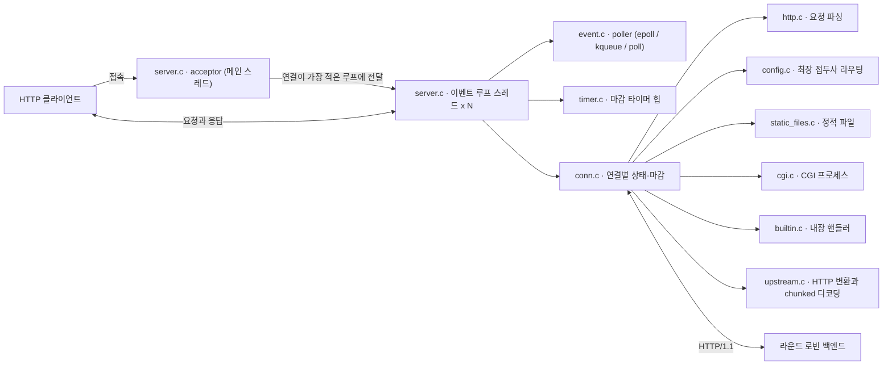
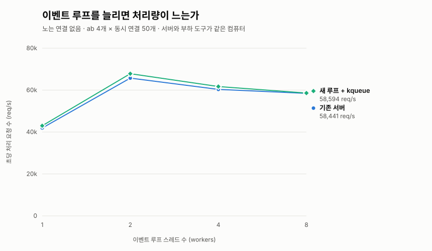
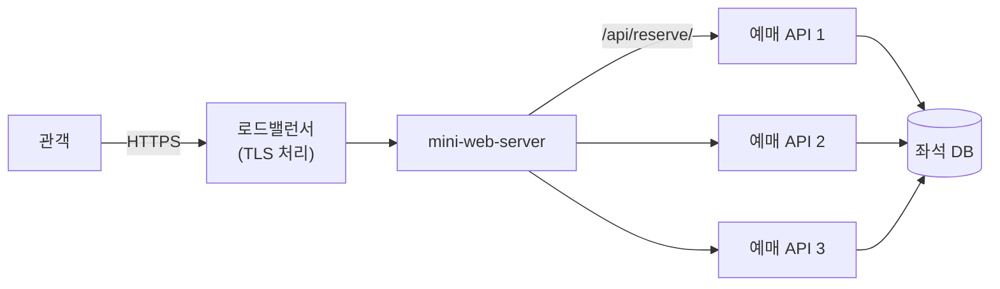

# mini-web-server

C와 POSIX API로 만든 HTTP/1.1 웹 서버. 정적 파일, CGI, 내장 핸들러, 리버스 프록시를 처리한다.

대규모 트래픽을 처리하는 웹 서버에는 **성능**, **안정성**, **확장성**이 중요하다. 이 서버는 세 가지를 목표로 개발했고, 성능과 안정성은 테스트로 효과를 확인했다. 확장성은 일부만 확인했다.

| 성질 | 목표 | 대표 테스트 결과 |
|---|---|---|
| [성능](#성능-performance) | 연결이 많아도 느려지지 않는다 | 노는 연결 9,000개에서 처리량 **3.1배** (13,536 → 41,667 req/s) |
| [안정성](#안정성-stability) | 일부가 고장 나도 멈추지 않는다 | 백엔드 1대 장애 시 실패한 요청 **33.3% → 0%** |
| [확장성](#확장성-scalability) | 자원을 늘리면 처리량도 는다 | 이벤트 루프 1 → 2개에서 **1.6배**. 4개 이상은 확인하지 못함 |

정글 13기 13주차 13팀 프로젝트.

**목차** · [내부 구조](#내부-구조) · [성능](#성능-performance) · [안정성](#안정성-stability) · [확장성](#확장성-scalability) · [티켓팅 날로 보는 강점과 한계](#실제-서비스에-적용한다면-콘서트-티켓팅-날) · [설정](#설정) · [테스트](#테스트) · [측정 재현](#측정-재현) · [빠른 시작](#빠른-시작) · [팀 PR 통합 기록](#팀-pr-통합-기록)

## 내부 구조



- acceptor가 연결을 받아 이벤트 루프에 넘기고, 각 루프는 자기 연결을 poller로 감시한다.
- 요청은 **프록시 규칙 → `/cgi-bin/` → `/builtin/` → 정적 파일** 순서로 처리한다.
- 프록시는 라운드 로빈으로 백엔드를 고르고, 실패한 백엔드는 잠시 건너뛰며, 응답은 받는 대로 스트리밍한다.

<br/>

연결 유지는 구간마다 다르다.

```text
클라이언트 ── keep-alive로 연결 유지 ──▶ mini-web-server ── 요청마다 새 연결 ──▶ 백엔드
           (연결 하나로 최대 100개 요청)                    (HTTP/1.1 + Connection: close)
```


- 백엔드와 HTTP/1.1을 쓰는 이유는 연결 유지가 아니라 `chunked` 응답을 받는 대로 중계하기 위해서다. 백엔드 연결 재사용은 아직 없다.
---

아래 세 절은 **정의 → 구현한 기능 → 대표 테스트** 순서다. 기능 상태는 ✅ 구현 · ⚠️ 일부 · ❌ 미구현. 측정은 Apple M5(10코어) MacBook, macOS에서 서버와 부하 도구(`ab`)를 같은 컴퓨터에 두고 했다.

<br/>

## a. 성능 (Performance)

> **성능이란** 주어진 자원으로 요청을 얼마나 빠르게, 많이 처리하는가. 처리량(초당 요청 수)과 지연(응답까지 걸리는 시간)으로 잰다.

목표: 일이 없는 연결이 많아도 실제 요청 처리가 느려지지 않는다.

| 기능 | 상태 | 내용 | 코드 |
|---|:---:|---|---|
| 이벤트 기반 I/O | ✅ | `epoll`(Linux)·`kqueue`(macOS)로 준비된 fd만 받음. `poll`도 선택 가능 | `event*.c` |
| 등록 방식 루프 | ✅ | 연결 상태가 바뀔 때만 감시 목록을 갱신, 이벤트가 온 연결만 처리 | `server.c` |
| 타이머 힙 | ✅ | 마감 시각을 최소 힙으로 관리해 전체 순회 없이 찾음 | `timer.c` |
| 논블로킹 상태 머신 | ✅ | 어떤 함수도 소켓을 기다리지 않음 | `conn.c` |
| 클라이언트 keep-alive · 파이프라이닝 | ✅ | 클라이언트 ↔ 서버 구간. 연결 하나로 최대 100개 요청 | `conn.c`, `http.c` |
| 응답 스트리밍 | ✅ | 백엔드 응답을 모으지 않고 받는 대로 전달 | `conn.c`, `upstream.c` |
| `sendfile` | ❌ | 정적 파일을 64 KiB씩 `read` → `send`로 복사 | `conn.c` |
| 백엔드 연결 재사용 | ❌ | 서버 ↔ 백엔드 구간은 요청마다 새 연결 | `upstream.c` |

### 대표 테스트: 대기 연결 수에 따른 처리량

**검증 대상**: 이벤트 기반 I/O, 등록 방식 루프, 타이머 힙 (PR #31)
**방법**: 루프 1개에 요청을 보내지 않는 연결 N개를 붙여 두고, 활성 연결 50개로 `GET /index.html`을 8초간 반복 요청 (3회 중앙값)

**비교 대상**: 같은 서버에서 이벤트 루프가 연결을 다루는 방식만 다르다. 노는 연결 9,000개 중 일이 생긴 연결이 5개일 때, 루프가 한 바퀴에 확인하는 연결 수:

| 루프의 한 바퀴 | 개선 전 (`5bae131`) | 루프만 개선 (poll) | 루프 개선 + kqueue (현재) |
|---|---|---|---|
| ① 감시 목록 준비 | 9,000개로 새로 만듦 | 바뀐 것만 고침 | 바뀐 것만 고침 |
| ② 커널 대기 | 9,000개 | 9,000개 | **5개** |
| ③ 일이 생긴 연결 찾기 | 9,000개 | 9,000개 | **5개** |
| ④ 마감 지난 연결 찾기 | 9,000개 | 타이머 힙 | 타이머 힙 |
| ⑤ 끝난 연결 정리 | 9,000개 | 5개 | 5개 |


| 노는 연결 수 | 개선 전 | 루프만 개선 (poll) | 루프 개선 + kqueue |
|---:|---:|---:|---:|
| 0 | 42,233 | 42,176 | 43,012 |
| 1,000 | 36,788 | 37,063 | 43,009 |
| 2,500 | 27,033 | 27,984 | 42,614 |
| 5,000 | 20,449 | 20,827 | 42,043 |
| 9,000 | 13,536 (−68%) | 14,135 (−66%) | **41,667 (−3%)** |
| p99 지연 (9,000개) | 7 ms | 7 ms | **3 ms** |

초당 처리 요청 수, 실패 0건.

- 가장 무거운 ②③을 바꾼 kqueue만 노는 연결 수와 상관없이 처리량을 유지했다.
- 루프만 개선한 효과는 약 4%다. 루프 개선은 kqueue·epoll의 효과가 나도록 루프 쪽 전체 순회를 없앤 기반 작업이다.

<br/>

## b. 안정성 (Stability)

> **안정성이란** 일부 구성 요소가 고장 나거나 예상 밖의 입력과 부하가 와도 서비스가 계속 동작하는가. 실패한 요청의 비율, 감지와 회복에 걸리는 시간으로 본다.

목표: 백엔드 장애, 느린 연결, 과부하가 생겨도 문제가 된 연결이나 백엔드만 정리하고 나머지는 계속 처리한다.

| 기능 | 상태 | 내용 | 코드 |
|---|:---:|---|---|
| 클라이언트 타임아웃 | ✅ | 유휴 5초, 헤더 10초, 본문 30초, 송신 10초. 느린 연결(Slowloris)은 408 | `conn.c` |
| 백엔드 타임아웃 | ✅ | 연결 1초, 응답 5초, CGI 5초. 넘으면 504 | `conn.c` |
| 동시 연결 한도 | ✅ | 최대 10,000. 넘으면 503으로 즉시 거절 | `server.c` |
| 요청 크기 한도 | ✅ | 헤더 8 KiB·32개 초과 431, 본문 1 MiB 초과 413 | `http.h` |
| Request smuggling 방지 | ✅ | 본문 경계가 모호하면 400 | `http.c` |
| 백엔드 장애 조치 | ✅ | 실패한 백엔드를 10초간 빼고 재시도. `POST`는 보내기 전 실패만 재시도 | `conn.c`, `config.c` |
| 헬스체크 | ⚠️ | passive만 지원(실제 요청의 실패로 판단). active 없음 | `config.c` |
| 백프레셔 | ✅ | 클라이언트에게 보낼 데이터가 남으면 백엔드 읽기를 멈춤 | `conn.c` |
| fd 고갈 대응 | ✅ | `EMFILE`이면 100 ms 동안 accept 중단 | `server.c` |
| 오류 격리 | ✅ | 클라이언트가 먼저 끊어도(`SIGPIPE`) 그 연결만 닫힘 | `main.c` |
| 우아한 종료 | ✅ | 종료 신호에도 처리 중인 응답은 끝까지 보냄 | `server.c` |
| 스레드 안전성 | ✅ | 공유 값은 atomic·mutex, `make tsan`으로 검사 | `server.c`, `cgi.c` |

### 대표 테스트: 백엔드 장애 시 실패율

**검증 대상**: 백엔드 장애 조치, passive 헬스체크, 백엔드 타임아웃 (PR #30 연결 실패 우회, PR #33 응답 없음 우회)
**방법**: 리버스 프록시 뒤 백엔드 3대, 단계마다 `/api/` 요청 300개(동시 10개)


| 단계 | 장애 조치 없음 (`77886d0`) | 연결 실패만 우회 (PR #30) | 현재 (PR #33) |
|---|---:|---:|---:|
| 3대 정상 | 0% | 0% | 0% |
| 1대 종료 (`SIGKILL`) | 33.3% (502) | 0% | **0%** |
| 종료한 1대 재시작 후 | 0% | 0% | **0%** |
| 1대 멈춤 (`SIGSTOP`, 응답 없음) | 33.3% (504) | 1.7% (504) | **0%** |

- 장애 백엔드는 제외되고 남은 2대가 나눠 처리했다. 재시작한 백엔드는 10초 뒤 다시 분배 대상이 된다.
- "1대 멈춤"에서 10건은 3초 기다린 뒤 성공했다. 멈춘 백엔드를 처음 감지하기 전에 그쪽으로 간 요청이다.

<br/>

## c. 확장성 (Scalability)

> **확장성이란** 자원을 늘렸을 때 처리량도 그만큼 늘어나는가. 성능이 "지금 얼마나 처리하나"라면 확장성은 "늘리면 얼마나 더 처리하나"다. 코어를 늘리는 수직 확장과 서버 대수를 늘리는 수평 확장이 있다.

목표: 수직 확장은 멀티 이벤트 루프로 코어를 모두 쓰고, 수평 확장은 리버스 프록시의 부하 분산으로 뒤쪽 서버를 늘린다.

| 기능 | 상태 | 내용 | 코드 |
|---|:---:|---|---|
| 멀티 이벤트 루프 | ✅ | acceptor 1개 + 루프 N개(기본 CPU 코어 수, 최대 8). 연결이 가장 적은 루프에 배정 | `server.c` |
| 리버스 프록시 | ✅ | 경로 접두사별 백엔드 묶음 | `config.c` |
| 부하 분산 | ⚠️ | 라운드 로빈만 지원 | `config.c` |
| 설정 파일 | ✅ | 루프 수, 라우팅 등을 재빌드 없이 변경(재시작 필요) | `config.c` |

### 대표 테스트: 이벤트 루프 수에 따른 처리량

**검증 대상**: 멀티 이벤트 루프 (PR #29). 이 기능은 성능 개선 전에도 있었으므로 전후 비교가 아니라 루프 수에 따른 처리량을 본다.
**방법**: 노는 연결 없이 `workers`를 1, 2, 4, 8로 바꾸고 `ab` 4개를 동시에 실행해 합산



| 루프 수 | 개선 전 (`5bae131`) | 루프 개선 + kqueue |
|---:|---:|---:|
| 1 | 41,924 | 43,002 |
| 2 | 65,735 | **67,826** |
| 4 | 60,343 | 61,703 |
| 8 | 58,441 | 58,594 |

**확장성은 충분히 검증하지 못했다.**

- 루프 2개에서 약 1.6배(이상적인 2배의 약 80%). 4개, 8개에서는 오히려 줄었다.
- 서버와 `ab` 4개가 같은 컴퓨터의 코어를 나눠 써서 부하 도구가 먼저 한계에 닿았을 가능성이 크지만, 서버 쪽 원인과 구분하지 못했다.
- 제대로 재려면 부하 도구를 다른 컴퓨터에서 실행하고 서버와 부하 도구의 CPU 사용률을 함께 기록해야 한다.

---

<br/>

## 실제 서비스에 적용한다면: 콘서트 티켓팅 날

이 서버는 nginx처럼 **앞단에서 연결을 받아 뒤쪽 서버들에 나눠 주는 자리**에 둔다. 예매가 열리는 날을 시간 순서로 따라가며 상용 웹 서버(nginx 등)와 비교한다. 장면은 설계 예시이며, 티켓팅 규모로 측정하지는 않았다.



✅ 이 서버로 대응 · ⚠️ 일부 대응 · ❌ 기능 없음

| 시각 | 벌어지는 일 | 이 서버 | 이 서버의 대응과 근거 | 상용 웹 서버·서비스의 방식 |
|---|---|:---:|---|---|
| 09:50 | 예매 페이지를 켜 둔 관객들이 오픈을 기다림. 대기 화면이 몇 초마다 남은 시간을 확인해 keep-alive 연결 수천 개가 열려 있음 | ✅ | 대기 연결이 많아도 처리량 유지. [성능 테스트](#성능-performance): 노는 연결 9,000개에서 3.1배. 단 서버 1대의 동시 연결 한도는 10,000개라, 대기 인원이 수만 명이면 여러 대를 두어야 함 | 같은 방식. nginx도 epoll·kqueue 이벤트 루프로 대기 연결을 다룸 |
| 10:00 | 예매 오픈, 접속 폭주 | ⚠️ | 연결 한도를 넘으면 503과 `Retry-After`로 바로 거절해 서버 전체는 멈추지 않음(통합 테스트). 하지만 누가 거절될지는 운이라 순서가 보장되지 않고, 거절된 관객의 새로고침이 폭주를 키움 | 사용자에게 503을 보여 주지 않고 **대기열**을 씀. 대기열 서비스(Cloudflare Waiting Room, NetFUNNEL 등)가 번호표를 주고 예매 서버가 감당할 만큼만 입장시키며, 웹 서버는 입장 토큰을 검사(nginx `auth_request`). 503 거절(nginx `limit_conn`)은 최후 방어선. 아래 "대기열은 어디에 두나" 참고 |
| 10:01 | 매크로가 초당 수십 번 예매 요청 | ❌ | 요청 제한 없음. 웹 서버에서는 IP·경로 기준의 거친 제한(토큰 버킷으로 세고 넘으면 429)을 추가할 수 있음 | 여러 계층에서 나눠 막음. 웹 서버는 nginx `limit_req`·`limit_conn`으로 IP·경로 기준 제한, 매크로 탐지는 CDN·WAF의 봇 탐지와 CAPTCHA, 계정당 횟수는 애플리케이션 |
| 10:01 | 헤더를 아주 천천히 보내며 연결을 붙잡는 공격 | ✅ | 헤더 마감(10초)이 지나면 408로 끊음. 통합 테스트(Slowloris) | 같은 방식. nginx `client_header_timeout` |
| 10:02 | 예매 API 서버 1대가 죽음 | ✅ | 자동으로 제외하고 다른 서버로 재시도. [안정성 테스트](#안정성-stability): 실패 33.3% → 0% | 같은 방식. nginx `max_fails`·`fail_timeout`, `proxy_next_upstream` |
| 10:02 | 예매 API 서버 1대가 응답 없이 멈춤 | ⚠️ | 감지한 뒤로는 우회(실패 0%)하지만, 감지 전에 그쪽으로 간 요청은 응답 시간 초과(예제 설정 `proxy_timeout_ms` 3초)까지 기다림. [안정성 테스트](#안정성-stability) | active 헬스체크(nginx Plus, HAProxy, AWS ALB)가 몇 초마다 직접 확인해 사용자보다 먼저 장애를 찾음 |
| 10:03 | 결제 버튼을 누른 순간 예매 서버 응답이 멈춤 | ✅ | 결제(`POST`)는 이미 처리됐을 수 있으므로 다른 서버로 다시 보내지 않음 → 중복 결제 없음. 조회(`GET`)만 재시도. 통합 테스트. 단 관객은 504를 받으므로 결제됐는지는 예매 내역에서 확인해야 함 | 같은 방식. nginx도 기본적으로 `POST` 같은 요청은 다음 서버로 넘기지 않음. 결제 서비스는 멱등 키로 안전한 재시도를 지원 |
| 10:10 | 매진, 취소표를 찾아 수만 명이 같은 좌석 현황을 계속 새로고침 | ❌ | 좌석 배치도 같은 정적 파일은 예매 서버를 거치지 않고 직접 응답. 하지만 좌석 현황 API 응답은 캐시가 없어 매번 예매 서버로 넘김 → 예매 서버와 DB가 같은 답을 계속 만들다 실제 예매 요청까지 느려질 수 있음 | `proxy_cache`로 좌석 현황 응답을 1~2초 저장(마이크로캐싱)해 뒤쪽 요청을 초당 1번 수준으로 줄임. 예매(`POST`)는 캐시하지 않음. 정적 파일은 CDN. 아래 "취소표 새로고침과 캐시" 참고 |
| 10:10 | 남은 좌석을 실시간으로 알려 주고 싶음 | ❌ | WebSocket 미지원 | `Upgrade` 헤더 프록시, 별도 실시간 서버 |
| 하루 종일 | 로그인·결제 등 모든 통신은 HTTPS | ❌ | TLS 미지원이라 앞단 로드밸런서가 TLS를 처리해야 함 | nginx `ssl` |
| 다음 공연 | 더 큰 공연이라 예매 서버를 늘림 | ✅ | 설정 한 줄로 백엔드 추가(재시작 필요, 경로당 최대 8대), CPU 코어 수만큼 이벤트 루프(기본 최대 8개, `workers`로 64개까지). 단 루프 증설 효과는 2개까지만 확인했다([확장성](#확장성-scalability)) | nginx는 `upstream`에 서버를 추가하고 재시작 없이 `reload`. 웹 서버 자체를 여러 대 둘 때는 앞단 L4 로드밸런서 |

- **강점**: 대기 연결이 많아도 느려지지 않고, 폭주와 느린 연결 공격에 서버가 멈추지 않으며, 예매 서버 장애를 우회하면서 결제는 중복되지 않는다.
- **보완할 점**: 대기열, 요청 제한, 캐시, WebSocket, HTTPS가 없다. 503 거절은 서버를 지키는 최후 방어선일 뿐 사용자 경험의 해결책은 아니다.

**그 밖의 한계**: 백엔드 연결 재사용 없음(nginx `upstream keepalive`, nginx도 기본값은 재사용 안 함) · `sendfile` 미사용 · HTTP/2 미지원 · 설정 변경 시 재시작 필요(nginx는 `reload`) · Linux(epoll)에서는 측정하지 않음.

<details>
<summary><b>대기열은 어디에 두나</b></summary>

10:00 장면의 대기열은 커널의 accept 대기열이 아니라 사람에게 번호표를 주는 **별도 서비스**다.

| | accept 대기열 (listen backlog) | 대기열 서비스 |
|---|---|---|
| 위치 | 커널, 리스닝 소켓마다 | 별도 서버 + 공유 저장소(Redis 등) |
| 줄 서는 것 | 아직 `accept()`하지 않은 TCP 연결 | 예매하려는 사람 |
| 규모 | 128칸 정도, 밀리초 | 수만~수십만 명, 분 단위 |
| 사용자에게 | 보이지 않음 | "대기 순번 12,345번" 화면 |

웹 서버가 여러 대여도 순번은 하나여야 하고, 순번을 오래 유지하며, 입장 속도를 한 곳에서 정해야 하므로 웹 서버 밖에 둔다. 웹 서버는 두 가지를 맡는다.

| 웹 서버의 역할 | 이 서버 | nginx |
|---|:---:|---|
| `/queue/` 요청을 대기열 서비스로 넘기기 | ✅ `proxy /queue/ <주소>` | `proxy_pass` |
| 예매 요청의 입장 토큰 검사(대기열 건너뛰기 차단) | ❌ 추가 필요 | `auth_request` |

</details>

<details>
<summary><b>취소표 새로고침과 캐시</b></summary>

매진 뒤 수만 명이 좌석 현황을 새로고침하면, 요청은 **모두 같은 것을 묻고** 답은 1초 사이에 거의 바뀌지 않는다.

```text
캐시 없음:  새로고침 10만 번/초 ──▶ 웹 서버 ──▶ 예매 서버·DB 10만 번
캐시 1초:   새로고침 10만 번/초 ──▶ 웹 서버 ──(1초에 1번)──▶ 예매 서버·DB 1번
```

- 좌석 현황(`GET`)만 1~2초 저장한다. 최대 1~2초 늦은 정보지만 보여 주는 용도로는 충분하다.
- 예매(`POST`)는 캐시하지 않는다. 같은 좌석이 두 번 팔리지 않게 막는 것은 DB의 몫이다.
- 바뀌지 않는 파일(배치도 이미지, JS·CSS)은 CDN이 맡는다.

| 필요한 기능 | 이 서버 | nginx |
|---|:---:|---|
| 정적 파일을 뒤쪽 서버 없이 응답 | ✅ | 같음 |
| `GET` 응답을 짧게 저장해 재사용 | ❌ | `proxy_cache` |
| 만료 순간 하나만 뒤쪽 서버로 보내기 | ❌ | `proxy_cache_lock` |
| 새 응답을 받는 동안 직전 응답 보여 주기 | ❌ | `proxy_cache_use_stale updating` |

남은 좌석이 바뀔 때 서버가 먼저 알려 주면(WebSocket, SSE) 새로고침 자체가 줄어든다.

</details>

## 설정

`./webserver -c conf/proxy.conf 18080 www`로 [예제 설정](conf/proxy.conf)을 읽는다. 변경 후 재시작하면 적용된다.

| 설정 | 기본값 | 동작 |
|---|---:|---|
| `workers` | 코어 수(최대 8) | 이벤트 루프 스레드 수 (1~64) |
| `event_backend` | `auto` | `auto`(Linux `epoll`, macOS `kqueue`), `poll`, `epoll`, `kqueue`. 환경변수 `WEBSERVER_EVENT_BACKEND`가 우선 |
| `keepalive_timeout_ms` | 5000 | 다음 요청의 첫 바이트를 기다리는 시간 |
| `header_timeout_ms` | 10000 | 헤더 전체를 받기까지의 시간 |
| `body_timeout_ms` | 30000 | 본문 전체를 받기까지의 시간 |
| `cgi_timeout_ms` | 5000 | CGI 실행 제한 시간 |
| `proxy_connect_timeout_ms` | 1000 | 백엔드 연결 제한 시간 |
| `proxy_timeout_ms` | 5000 | 백엔드 I/O를 기다리는 시간(예제 파일은 3000) |
| `proxy_fail_timeout_ms` | 10000 | 실패한 백엔드를 건너뛰는 시간 |
| `proxy_retry_timeout_ms` | 5000 | 응답 시간 초과 뒤 재시도를 시작할 수 있는 한도 |
| `proxy <접두사> <주소>...` | | 접두사로 시작하는 요청을 백엔드들에 라운드 로빈으로 전달 |

## 테스트

| 확인하는 것 | 주요 검사 항목 | 테스트 |
|---|---|---|
| HTTP 요청 해석 | 헤더 파싱, 잘못된 요청, keep-alive 판정, 파이프라이닝 | `test_http`, `smoke-concurrency` |
| 요청 본문과 smuggling 방지 | `chunked` 본문, TE·CL 충돌 400, 지원하지 않는 코딩 501, 1 MiB 초과 413 | `test_http`, `smoke-dynamic` |
| 정적 파일과 경로 탈출 차단 | MIME, 20 MB 파일 일치, `HEAD`, 301·403·404·405, `../`·`%2e%2e`·심볼릭 링크 탈출 403 | `test_static`, `smoke` |
| CGI·내장 핸들러 | 환경변수, 파이프 교착 없음, 타임아웃 504, 40개 동시 실행, 좀비 없음 | `test_dynamic`, `smoke-dynamic` |
| 리버스 프록시 중계 | 헤더 재작성, 20 MiB 스트리밍, 고정 길이·`chunked`·EOF 경계, 잘린 응답 | `test_dynamic`, `smoke-dynamic` |
| 부하 분산과 장애 조치 | 라운드 로빈, 죽은·멈춘 백엔드 우회, `POST` 재시도 안 함, 복구 | `test_dynamic`, `smoke-dynamic` |
| 동시성과 이벤트 루프 | 동시 요청 400개, 노는 연결 1,000개, 루프 분배, 타이머 힙 | `test_timer`, `smoke-concurrency` |
| 타임아웃·한도·종료 | Slowloris 408, 503과 `Retry-After`, `SIGPIPE` 생존, 우아한 종료 | `smoke-concurrency`, `smoke-dynamic` |
| 메모리·스레드 안전성 | AddressSanitizer, ThreadSanitizer | `make test-asan`, ASan·TSan 서버 |

**결과** (2026-11-26, macOS): 단위 261개, 통합 155개 검사 항목 모두 통과. kqueue·`poll` 양쪽에서 통과했고 ASan·TSan 보고 없음. Linux(epoll)에서는 아직 실행하지 않았다.

```sh
make test                                   # 단위 테스트
make smoke smoke-dynamic smoke-concurrency  # 통합 테스트
make asan test-asan && WEBSERVER=./webserver_asan make smoke-dynamic smoke-concurrency
make tsan && WEBSERVER=./webserver_tsan make smoke-concurrency
WEBSERVER_EVENT_BACKEND=poll make smoke smoke-dynamic smoke-concurrency
```

## 측정 재현

| 스크립트 | 측정 |
|---|---|
| `bench/bench.py idle` | 노는 연결 N개를 붙인 채 처리량·지연 측정 |
| `bench/bench.py workers` | 루프 수별 처리량 |
| `bench/failover.py` | 백엔드 정상 → 종료 → 재시작 → 멈춤 단계별 상태 코드 |
| `bench/plot.py` | 결과 CSV를 SVG 그래프로 |

결과는 `bench/results/`에 있다.

<details>
<summary>Linux(WSL)에서 재현하기</summary>

```sh
sudo apt install -y apache2-utils                                   # ab
make
git worktree add ../before 5bae131 && make -C ../before webserver   # 이벤트 백엔드 작업 전
git worktree add ../pre30 77886d0 && make -C ../pre30 webserver     # 장애 조치 작업 전

python3 bench/bench.py idle --series before=../before/webserver: \
    --series poll=./webserver:poll --series epoll=./webserver:epoll --csv bench/results/linux-idle.csv
python3 bench/bench.py workers --series before=../before/webserver: \
    --series epoll=./webserver:epoll --csv bench/results/linux-workers.csv
python3 bench/failover.py --series before=../pre30/webserver --series retry=./webserver \
    --csv bench/results/linux-failover.csv
for e in idle workers failover; do python3 bench/plot.py bench/results/linux-$e.csv bench/results/linux-$e.svg; done
```

- `--series 이름=실행파일:백엔드`에서 백엔드를 비우면 서버 기본값.
- 측정 중에는 무거운 프로그램을 끄고, 측정을 동시에 두 개 돌리지 않는다(포트 변경은 `BENCH_PORT`).
- 노는 연결은 RST로 끊어 TIME_WAIT로 포트가 고갈되지 않게 한다. macOS는 임시 포트가 약 16,000개라 9,000개까지 측정했다.

</details>

## 빠른 시작

```sh
make
make run                            # http://localhost:18080/
```

| 기능 | 확인 방법 |
|---|---|
| 정적 파일 | `/`, `/docs/` |
| CGI · 내장 핸들러 | `/cgi-bin/add?a=1&b=2`, `/builtin/add?a=1&b=2`, `/form.html` |
| 리버스 프록시 | 터미널 두 개에서 `make backends`, `make run-proxy` → `curl http://localhost:18080/api/hello` 반복 시 백엔드 3대가 번갈아 응답 |
| 장애 조치 | 위 상태에서 백엔드 하나를 종료 → 남은 백엔드만 응답 |

## 팀 PR 통합 기록

<details>
<summary>PR #24와 PR #26을 합친 근거</summary>

| 항목 | [PR #24 · Base Single Server](https://github.com/1224kang/mini-web-server/pull/24) | [PR #26 · 미니 웹 서버 1~6단계](https://github.com/1224kang/mini-web-server/pull/26) |
|---|---|---|
| 동시 접속 | 워커가 연결 하나를 담당. 유휴 keep-alive도 워커를 점유 | 단일 스레드 `poll` 루프 |
| 정적·동적 처리 | 정적 `GET`과 백엔드 프록시 | 정적·프록시 `HEAD`, CGI, 내장 `add`·`echo` |
| 프록시 응답 | HTTP/1.1로 받는 대로 전달, `chunked` 중계 | HTTP/1.0으로 EOF까지 모은 뒤 전송 |
| 타임아웃 | 설정 파일에서 변경 | 헤더·본문 마감, 코드에 고정 |
| 메모리 검사 | 일반·ASan 산출물 분리, `make test-asan` | `make asan`이 같은 실행 파일을 다시 만듦 |
| 요청 본문 | 최대 10 MiB, `Expect: 100-continue` 지원 | 최대 1 MiB, 미구현 |

| 가져온 요소 | 적용 방식 |
|---|---|
| #26의 이벤트 루프와 연결 상태 머신 | 소켓·파이프를 루프가 관리. 이후 poller 등록 방식과 epoll·kqueue로 교체 |
| #24의 응답 스트리밍과 HTTP/1.1 백엔드 | 본문을 조각 단위로 받아 바로 전송, 최대 64 KiB만 보관 |
| #24의 설정 파일과 #26의 단계별 마감 | keep-alive·헤더·본문 제한 시간을 각각 설정 |
| #24의 ASan 빌드 분리 | `build/release/`·`webserver`와 `build/asan/`·`webserver_asan` |

두 구조를 합쳐, 워커마다 이벤트 루프를 돌려 여러 연결을 처리한다. 큰 업로드와 `Expect: 100-continue`는 후속 과제다.

</details>
