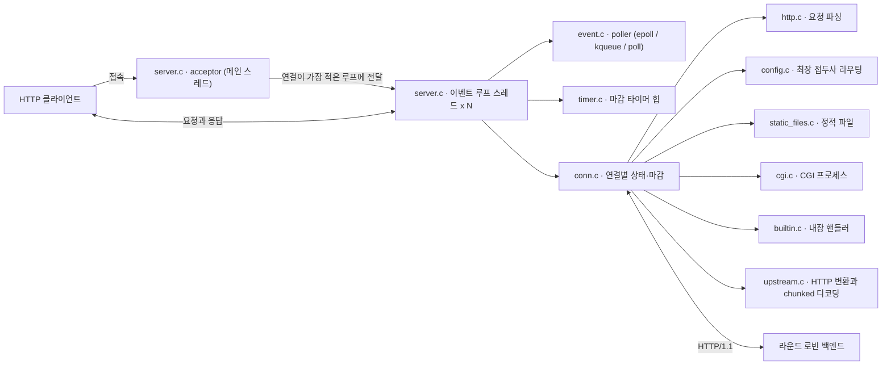
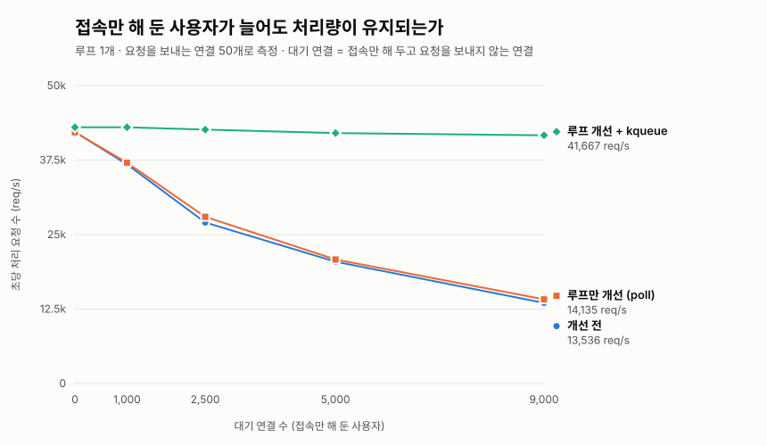
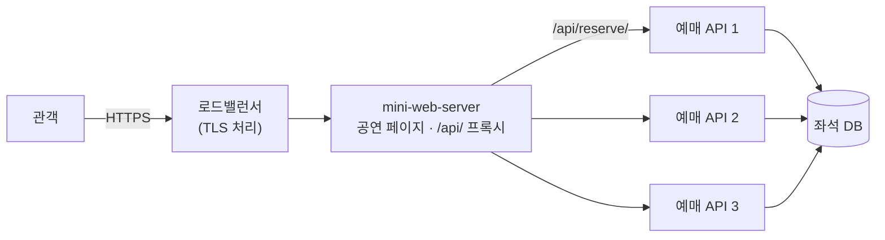

# mini-web-server

C와 POSIX API로 만든 HTTP/1.1 웹 서버. 정적 파일, CGI, 내장 핸들러, 리버스 프록시를 처리한다.

대규모 트래픽을 처리하는 웹 서버에는 세 가지가 중요하다. 연결이 많아도 느려지지 않는 **성능**, 일부가 고장 나도 멈추지 않는 **안정성**, 자원을 늘리면 처리량도 느는 **확장성**. 이 서버는 세 가지를 목표로 개발했고, 각각을 테스트로 확인했다.

| 성질 | 목표 | 대표 테스트 결과 |
|---|---|---|
| [성능 (Performance)](#성능-performance) | 대기 중인 연결이 많아도 실제 요청 처리가 느려지지 않는다 | 노는 연결 9,000개에서 처리량 13,536 → **41,667 req/s** (약 3.1배), p99 7 ms → 3 ms |
| [안정성 (Stability)](#안정성-stability) | 백엔드 장애, 느린 연결, 과부하에도 서버 전체가 멈추지 않는다 | 백엔드 3대 중 1대 종료·멈춤 시 실패한 요청 33.3% → **0%** |
| [확장성 (Scalability)](#확장성-scalability) | CPU 코어와 백엔드 서버를 늘려 처리량을 늘릴 수 있다 | 이벤트 루프 1개 → 2개에서 처리량 43,002 → **67,826 req/s** (약 1.6배) |

정글 13기 13주차 13팀 프로젝트.

## 목차

- [빠른 시작](#빠른-시작)
- [내부 구조](#내부-구조)
- [성능 (Performance)](#성능-performance)
- [안정성 (Stability)](#안정성-stability)
- [확장성 (Scalability)](#확장성-scalability)
- [실제 서비스에 적용한다면: 콘서트 티켓팅 날](#실제-서비스에-적용한다면-콘서트-티켓팅-날)
- [설정](#설정)
- [측정 재현](#측정-재현)
- [테스트](#테스트)
- [팀 PR 통합 기록](#팀-pr-통합-기록)

## 빠른 시작

```sh
make
make run                            # http://localhost:18080/
make run PORT=8080
```

| 기능 | 확인 방법 |
|---|---|
| 정적 파일 | `/`, `/docs/` |
| CGI · 내장 핸들러 | `/cgi-bin/add?a=1&b=2`, `/builtin/add?a=1&b=2`, `/form.html` |
| 리버스 프록시 | 터미널 두 개에서 `make backends`, `make run-proxy` 실행 후 `curl http://localhost:18080/api/hello` 반복 → 백엔드 3대가 번갈아 응답 |
| 장애 조치 | 위 상태에서 백엔드 하나를 종료 → 남은 백엔드만 응답, 서버 로그에 `marked down ... retrying next backend` |

## 내부 구조



1. `main.c`가 포트·문서 루트와 설정을 읽고 리스닝 소켓을 연다. `server.c`의 acceptor가 연결을 받아 이벤트 루프 스레드에 넘기고, 각 루프는 자기 연결의 fd, 종료 신호, CGI 자식 종료를 poller(`event.h`)로 감시한다.
2. `http.c`가 요청 헤더를 파싱하고, `conn.c`가 필요한 본문을 읽는다. 요청은 **프록시 규칙 → `/cgi-bin/` → `/builtin/` → 정적 파일** 순서로 처리한다.
3. 정적 파일은 작은 조각으로 읽어 보낸다. CGI는 자식의 stdin과 stdout을 동시에 감시하고, 출력으로 HTTP 응답을 구성한 뒤 자식을 회수한다.
4. 프록시는 가장 긴 경로 접두사의 백엔드 중 하나를 라운드 로빈으로 고른다. 실패한 백엔드는 잠시 건너뛰고 다른 백엔드로 재시도한다. 백엔드에는 요청마다 HTTP/1.1 연결을 쓰고, 응답 헤더를 확인한 뒤 본문을 스트리밍한다.

<details>
<summary>멀티 이벤트 루프</summary>

```text
[메인 스레드 = acceptor]                  [이벤트 루프 스레드 x N]
poll(listen, stop)                        poller_wait([wake, stop, 자식회수, 자기 연결들...])
  accept → 전체 연결 수 >= 한도면 503         wake: inbox 의 연결을 꺼내 conn_new
         → 연결이 가장 적은 루프의    ──▶    이벤트가 온 연결만 conn_handle
           inbox 에 넣고 wake 파이프에 1바이트  마감 지난 연결만 conn_timeout, 끝난 연결 정리
  stop  → listen 닫기, 루프 join
```

- 연결은 처음 맡은 루프에서 끝까지 처리한다. 그래서 `conn.c`의 상태 머신은 lock 없이 단일 스레드 때와 같은 코드로 돈다.
- 스레드끼리 공유하는 값만 보호한다. 전체·루프별 연결 수와 요청 통계, 라운드 로빈 카운터, 백엔드 down 시각은 atomic이고, CGI 고아 목록과 루프 inbox는 mutex다.
- 루프 하나가 느린 작업에 잠시 막혀도 다른 루프의 연결은 계속 진행된다.
- 시그널은 메인 스레드만 받는다(루프 스레드는 `pthread_sigmask`로 막음). 핸들러는 파이프에 1바이트를 쓰고, 루프들은 그 파이프를 감시해 종료와 CGI 자식 종료를 안다.
- fd를 만든 뒤 `FD_CLOEXEC`를 켜기 전에 다른 스레드가 CGI를 `fork`하면 그 fd가 자식에게 샌다. `accept`, 백엔드 `socket`, CGI의 `pipe`+`fork`는 같은 잠금(`cgi_fd_guard`) 안에서 한다.

</details>

<details>
<summary>이벤트 백엔드(poller)와 타이머 힙</summary>

루프는 `poll`을 직접 부르지 않고 `event.h`의 poller에 fd를 **등록**해 둔다. 백엔드는 실행할 때 고르며, 시작 로그에 `kqueue backend`처럼 표시된다.

| 백엔드 | 파일 | OS | 대기 비용 |
|---|---|---|---|
| `poll` | `event_poll.c` | 모두 | 등록된 fd 전체를 매번 커널에 넘기고 훑음: O(등록된 fd 수) |
| `epoll` | `event_epoll.c` | Linux | 커널이 등록을 들고 있고 준비된 fd만 돌려줌: O(준비된 fd 수) |
| `kqueue` | `event_kqueue.c` | macOS, BSD | epoll과 같음 |

| 루프가 하는 일 | 예전 | 지금 |
|---|---|---|
| 대기 | `poll`에 전체 목록 전달 | 미리 등록, 준비된 fd만 받음 |
| 일이 생긴 연결 찾기 | 모든 연결 확인 | 이벤트의 `ptr`(`struct watch`)로 바로 |
| 다음 마감 찾기 | 모든 연결의 마감 비교 | 타이머 힙 맨 위 |
| 마감 지난 연결 찾기 | 모든 연결 확인 | 타이머 힙에서 지난 것만 꺼냄 |
| 끝난 연결 정리 | 모든 연결 확인 | 이번 바퀴에 건드린 연결만 |

- 연결의 감시 fd·마감·종료 여부가 바뀌는 때는 그 연결을 건드린 직후뿐이다(`conn_new`, `conn_handle`, `conn_timeout`, `conn_shutdown`). 루프는 그때 `watch_touched`에서 셋을 함께 맞춘다. 한 바퀴의 일은 열린 연결 수가 아니라 일이 생긴 연결 수에 비례한다(마감 처리는 연결당 O(log n)).
- `conn.c`는 감시 중인 fd를 닫기 직전에 훅(`conn_set_close_hook`)을 부른다. epoll·kqueue는 등록을 커널이 들고 있어서, 루프 모르게 fd를 닫고 같은 번호로 새 fd를 열면(예: 프록시 재시도) 새 fd가 등록되지 않는다. 또 epoll은 `fork`로 자식이 같은 파일을 들고 있으면 `close` 뒤에도 등록이 남는다. 훅에서 등록을 먼저 지워 두 문제를 막는다.
- kqueue는 읽기와 쓰기를 따로 알려 주므로 한 fd의 결과가 두 번 올 수 있고(루프가 합침), 기다리는 이벤트가 없는(events=0) fd의 끊김은 알려 주지 않는다. macOS에서는 `poll`도 이 경우를 알려 주지 않아 동작 차이는 없었다.

</details>

<details>
<summary>백엔드 장애 조치</summary>

실제 요청의 실패(연결 실패, 응답 시간 초과)로 백엔드 상태를 판단한다(passive health check). 다시 보내도 안전한 요청만 다른 백엔드로 재시도한다.

| 상황 | 처리 |
|---|---|
| 연결 거부, 도달 불가, `proxy_connect_timeout_ms` 초과 | 그 백엔드를 `proxy_fail_timeout_ms` 동안 down으로 표시하고, 같은 요청을 아직 시도하지 않은 다음 백엔드로 보낸다. 요청을 한 바이트도 보내기 전이라 `POST`도 재시도한다. |
| down인 백엔드 | 라운드 로빈 순서에서 건너뛴다. 시간이 지나면 다시 후보가 되고, 또 실패하면 다시 down이 된다. |
| 살아 있는 백엔드가 없음 | down인 백엔드라도 한 번씩 시도해 복구를 확인한다. 모두 실패하면 502(마지막 실패가 연결 타임아웃이면 504). |
| 연결 후 `proxy_timeout_ms` 동안 응답 없음 | 그 백엔드를 down으로 표시한다. `GET`·`HEAD`이고 클라이언트에게 응답을 보내기 전이며 첫 시도부터 `proxy_retry_timeout_ms` 안이면 아직 시도하지 않은 백엔드로 재시도, 그 밖에는 504. `POST` 등은 백엔드가 이미 처리했을 수 있으므로 재시도하지 않는다. |
| 연결 후 응답이 망가지거나 중간에 끊김 | 요청을 이미 보냈으므로 재시도하지 않고 502. |

</details>

<details>
<summary>프록시 응답과 요청 본문의 경계</summary>

| 백엔드 응답 | 프록시의 완료 조건 |
|---|---|
| `Content-Length` | 선언된 바이트 수를 전달하면 완료 |
| `Transfer-Encoding: chunked` | 마지막 0 청크 뒤 빈 줄까지 읽음. HTTP/1.1 클라이언트에는 청크를 다시 만들고, HTTP/1.0 클라이언트에는 디코딩한 본문을 보낸 뒤 연결을 닫음. 청크 확장과 트레일러는 전달하지 않음 |
| 길이 헤더 없음 | 백엔드 EOF까지 중계한 뒤 클라이언트 연결을 닫음 |
| `HEAD`, 204, 304 | 헤더만 전송 |

응답 헤더 전송 전의 백엔드 오류는 502, 제한 시간 초과는 504. 응답 전송이 시작된 뒤 백엔드가 본문을 끝내지 못하면 해당 클라이언트 연결을 닫는다. [RFC 9112 §6.3 및 §7.1](https://www.rfc-editor.org/rfc/rfc9112.html#section-6.3) 참고.

요청 본문도 같은 규칙으로 끝을 정한다(`http_body_framing`). 본문 끝을 잘못 판단하면 뒤에 숨긴 요청이 별도 요청으로 처리되는 request smuggling이 생기므로, 모호한 경우는 거절하고 연결을 닫는다.

| 요청 헤더 | 처리 |
|---|---|
| `Content-Length` | 선언된 바이트 수만큼 읽음 |
| `Transfer-Encoding: chunked` | 마지막 0 청크까지 읽어 본문을 모음. CGI에는 `CONTENT_LENGTH`, 백엔드에는 `Content-Length`로 전달. 본문 뒤에 이어 온 요청은 keep-alive로 계속 처리 |
| `Transfer-Encoding`과 `Content-Length`가 함께 있음 | 400 |
| HTTP/1.0 요청의 `Transfer-Encoding`, `chunked`가 마지막이 아니거나 두 번 이상 | 400 |
| `gzip, chunked`처럼 지원하지 않는 코딩 | 501 |
| 잘못된 청크 형식, 1 MiB 초과 | 400, 413 |

</details>

---

성능·안정성·확장성 각 절은 구현한 기능 표와 대표 테스트 하나로 구성된다.

- 기능 상태: ✅ 구현 · ⚠️ 일부 구현 · ❌ 미구현
- 측정 환경: Apple M5(10코어) MacBook, macOS. 서버와 부하 도구(`ab`)를 같은 컴퓨터에서 실행. 측정 방법은 [측정 재현](#측정-재현) 참고.

## 성능 (Performance)

대기 중인 연결이 많아도 실제 요청 처리가 느려지지 않는 것이 목표. 이벤트 루프가 한 바퀴 돌 때 모든 연결을 훑지 않고, 일이 생긴 연결만 다루도록 만들었다.

### 구현한 기능

| 항목 | 상태 | 내용 | 코드 |
|---|:---:|---|---|
| 이벤트 기반 I/O | ✅ | Linux `epoll`, macOS `kqueue`. 준비된 fd만 돌려받음. `poll` 백엔드도 선택 가능 | `event*.c` |
| 등록 방식 루프 | ✅ | 연결을 건드린 직후에만 감시 목록을 갱신하고, 이벤트가 온 연결만 처리 | `server.c` |
| 타이머 힙 | ✅ | 마감 시각을 최소 힙으로 관리. 다음 마감과 마감 지난 연결을 전체 순회 없이 찾음 | `timer.c` |
| 논블로킹 상태 머신 | ✅ | 어떤 함수도 소켓을 기다리지 않음. 할 수 있는 만큼 진행하고 루프로 돌아감 | `conn.c` |
| Keep-Alive · 파이프라이닝 | ✅ | 연결 하나로 최대 100개 요청 | `conn.c` |
| 응답 스트리밍 | ✅ | 백엔드 응답을 모으지 않고 받는 대로 전달(고정 길이, `chunked`, EOF) | `conn.c`, `upstream.c` |
| `sendfile` | ❌ | 정적 파일을 64 KiB씩 `read` → `send`로 복사 | `conn.c` |
| 백엔드 연결 재사용 | ❌ | 백엔드와 요청마다 새 연결 | `upstream.c` |

### 대표 테스트: 대기 연결 수에 따른 처리량

**확인하는 기능**: 위 표의 **이벤트 기반 I/O**, **등록 방식 루프**, **타이머 힙**

**개선 내용** (PR #31)

- 개선 전에는 이벤트 루프가 한 바퀴마다 모든 연결을 훑었다. 일이 없는 keep-alive 연결이 늘수록 실제 요청 처리도 느려졌다.
- 등록 방식 루프: 연결을 poller에 한 번 등록해 두고, 연결 상태가 바뀔 때만 갱신한다. 이벤트에 딸린 포인터로 연결을 바로 찾는다.
- 타이머 힙: 연결마다의 마감 시각을 최소 힙에 두어, 다음 마감과 마감 지난 연결을 전체 순회 없이 찾는다.
- 이벤트 기반 I/O: 커널 대기를 `poll`에서 `epoll`(Linux)·`kqueue`(macOS)로 바꿔, 커널이 일이 생긴 연결만 돌려주게 했다.

**테스트 방법**: 이벤트 루프 1개에 요청을 보내지 않는 연결을 N개 붙여 두고, 활성 연결 50개로 `GET /index.html`을 8초간 반복 요청. 3회 중앙값.

**비교 대상**: 세 경우 모두 같은 서버이고, 이벤트 루프가 연결을 다루는 방식만 다르다. 이벤트 루프는 한 바퀴마다 아래 다섯 단계를 반복한다. 노는 연결이 9,000개이고 이번 바퀴에 일이 생긴 연결이 5개일 때, 각 단계에서 확인하는 연결 수는 다음과 같다.

| 단계 | 개선 전 | 루프만 개선 (poll) | 루프 개선 + kqueue |
|---|---|---|---|
| ① 감시 목록 준비 | 9,000개에 물어 목록을 **새로 만듦** | 만들어 둔 목록을 씀. 바뀐 연결만 고침 | 같음 |
| ② 커널 대기 | `poll`: 커널이 **9,000개 전부** 확인 | `poll`: **9,000개 전부** | `kqueue`: 커널이 일이 생긴 **5개만** 돌려줌 |
| ③ 일이 생긴 연결 찾기 | **9,000개** 결과를 전부 훑음 | **9,000개** 결과를 전부 훑음 | 돌려받은 **5개** |
| ④ 마감 지난 연결 찾기 | **9,000개**의 마감을 전부 확인 | 타이머 힙에서 지난 것만 | 같음 |
| ⑤ 끝난 연결 정리 | **9,000개** 전부 확인 | 이번 바퀴에 처리한 **5개**만 | 같음 |

| 이름 | 코드 | 차이 요약 |
|---|---|---|
| 개선 전 | `5bae131` (PR #31 머지 전 develop) | 다섯 단계 모두 전체 연결을 훑음 |
| 루프만 개선 (poll) | 현재 코드, `event_backend poll` | ①④⑤는 전체 순회를 없앴지만, ②③은 `poll`이라 여전히 전체를 훑음 |
| 루프 개선 + kqueue | 현재 코드 (기본값, Linux는 `epoll`) | 다섯 단계 모두 일이 생긴 연결만 다룸 |

멀티 이벤트 루프, 장애 조치 등 나머지 기능은 세 경우 모두 같다. 개선 전 → 루프만 개선 (poll)의 차이가 등록 방식 루프·타이머 힙의 효과이고, 루프만 개선 (poll) → 루프 개선 + kqueue의 차이가 이벤트 기반 I/O의 효과다.

**결과**



| 노는 연결 수 | 개선 전 | 루프만 개선 (poll) | 루프 개선 + kqueue |
|---:|---:|---:|---:|
| 0 | 42,233 | 42,176 | 43,012 |
| 1,000 | 36,788 | 37,063 | 43,009 |
| 2,500 | 27,033 | 27,984 | 42,614 |
| 5,000 | 20,449 | 20,827 | 42,043 |
| 9,000 | 13,536 (−68%) | 14,135 (−66%) | **41,667 (−3%)** |
| p99 지연 (9,000개) | 7 ms | 7 ms | **3 ms** |

초당 처리 요청 수. 실패 0건.

- 개선 전과 루프만 개선(poll)은 노는 연결이 늘수록 똑같이 느려진다. 가장 무거운 ②③이 둘 다 전체를 훑기 때문이다. ①④⑤를 줄인 효과는 약 4%(13,536 → 14,135)에 그친다.
- kqueue로 ②③까지 바꾸자 노는 연결 수와 거의 상관없이 처리량이 유지됐다. 루프 개선은 그 자체로 빨라지는 작업이 아니라, kqueue·epoll을 써도 루프 쪽 전체 순회가 남지 않게 한 기반 작업이다.

## 안정성 (Stability)

백엔드 장애, 느린 연결, 과부하가 생겨도 서버 전체가 멈추지 않는 것이 목표. 문제가 생긴 연결이나 백엔드만 정리하고 나머지 요청은 계속 처리한다.

### 구현한 기능

| 항목 | 상태 | 내용 | 코드 |
|---|:---:|---|---|
| 클라이언트 타임아웃 | ✅ | 유휴 5초, 헤더 10초, 본문 30초, 송신 10초. Slowloris 같은 느린 연결을 408로 끊음 | `conn.c` |
| 백엔드 타임아웃 | ✅ | 연결 1초, 응답 5초(예제 설정 3초), CGI 5초. 넘으면 504 | `conn.c` |
| 동시 연결 한도 | ✅ | 모든 루프 합계 최대 10,000. 넘으면 503으로 즉시 거절 | `server.c`, `main.c` |
| 요청 크기 한도 | ✅ | 헤더 8 KiB·32개 초과 431, 본문 1 MiB 초과 413 | `http.h` |
| Request smuggling 방지 | ✅ | `Transfer-Encoding`과 `Content-Length`가 함께 오는 등 본문 경계가 모호하면 400 | `http.c` |
| `chunked` 요청 본문 | ✅ | 디코딩해서 CGI·백엔드에 `Content-Length`로 전달 | `conn.c` |
| 백엔드 장애 조치 | ✅ | 연결 실패·응답 시간 초과가 난 백엔드를 10초간 제외하고 다른 백엔드로 재시도. `POST`는 요청을 보내기 전 실패만 재시도(중복 처리 방지) | `conn.c`, `config.c` |
| 헬스체크 | ⚠️ | passive만 지원(실제 요청의 실패로 판단). 주기적으로 확인하는 active 헬스체크 없음 | `config.c` |
| 백프레셔 | ✅ | 클라이언트에게 보낼 데이터가 남아 있으면 백엔드 읽기를 멈춤 | `conn.c` |
| fd 고갈 대응 | ✅ | `EMFILE`이면 100 ms 동안 accept 중단 | `server.c` |
| 오류 격리 | ✅ | `SIGPIPE` 무시. 클라이언트가 먼저 끊어도 그 연결만 닫힘 | `main.c` |
| 우아한 종료 | ✅ | `SIGINT`·`SIGTERM` 수신 시 처리 중인 응답을 끝까지 보낸 뒤 종료 | `server.c`, `conn.c` |
| 스레드 안전성 | ✅ | 공유 값은 atomic·mutex, fork 시 fd 누수 방지 잠금. `make tsan`으로 검사 | `server.c`, `cgi.c` |

### 대표 테스트: 백엔드 장애 시 실패율

**확인하는 기능**: 위 표의 **백엔드 장애 조치**, **헬스체크**(passive), **백엔드 타임아웃**

**개선 내용** (PR #30, #33)

- 개선 전에는 라운드 로빈 순서대로만 백엔드를 골랐다. 고장 난 백엔드 차례인 요청은 그대로 502·504를 받았다.
- 연결 실패 우회 (PR #30): 연결이 거부되거나 연결 시간 초과가 난 백엔드를 10초간 제외하고, 같은 요청을 다른 백엔드로 다시 보낸다. 요청을 한 바이트도 보내기 전이라 `POST`도 재시도한다.
- 응답 없음 우회 (PR #33): 연결은 됐지만 응답 시간 초과가 난 백엔드도 제외한다. 이때는 백엔드가 요청을 이미 처리했을 수 있으므로 `GET`·`HEAD`만 다른 백엔드로 재시도한다.
- 10초가 지나면 제외했던 백엔드를 다시 후보에 넣고, 다음 요청으로 복구 여부를 확인한다.

**테스트 방법**: 리버스 프록시 뒤 백엔드 3대, 단계마다 `/api/` 요청 300개(동시 10개). "1대 종료"는 연결 실패 우회를, "1대 멈춤"은 응답 없음 우회를, "재시작 후"는 제외했던 백엔드의 복구를 확인한다. 비교 대상은 장애 조치 없음(`77886d0`), 연결 실패만 우회(PR #30), 현재(PR #33).

**결과**


| 단계 | 장애 조치 없음 (`77886d0`) | 연결 실패만 우회 (PR #30) | 현재 |
|---|---:|---:|---:|
| 3대 정상 | 0% | 0% | 0% |
| 1대 종료 (`SIGKILL`) | 33.3% (502 100건) | 0% | **0%** |
| 종료한 1대 재시작 후 | 0% | 0% | **0%** |
| 1대 멈춤 (`SIGSTOP`, 연결은 되고 응답 없음) | 33.3% (504 100건) | 1.7% (504 5건) | **0%** |

- 장애 백엔드는 제외되고 남은 2대가 150개씩 처리. 재시작한 백엔드는 10초 뒤 다시 분배 대상이 된다.
- "1대 멈춤"에서 10건은 3초 대기 후 성공. 멈춘 백엔드를 처음 감지하기 전에 이미 그쪽으로 간 요청이다.

## 확장성 (Scalability)

CPU 코어와 백엔드 서버를 늘리면 처리량도 늘어나는 것이 목표. 코어는 멀티 이벤트 루프로, 백엔드는 리버스 프록시의 부하 분산으로 늘린다.

### 구현한 기능

| 항목 | 상태 | 내용 | 코드 |
|---|:---:|---|---|
| 멀티 이벤트 루프 | ✅ | acceptor 1개 + 루프 N개(기본 CPU 코어 수, 최대 8). 연결이 가장 적은 루프에 배정 | `server.c` |
| 리버스 프록시 | ✅ | 경로 접두사별 백엔드 묶음, 가장 긴 접두사 우선 | `config.c` |
| 부하 분산 | ⚠️ | 라운드 로빈만 지원. Least Connections, 가중치 없음 | `config.c` |
| 설정 파일 | ✅ | 루프 수, 이벤트 백엔드, 타임아웃, 라우팅을 재빌드 없이 변경(재시작 필요) | `config.c` |

### 대표 테스트: 이벤트 루프 수에 따른 처리량

**확인하는 기능**: 위 표의 **멀티 이벤트 루프**. **리버스 프록시**·**부하 분산**으로 백엔드를 늘렸을 때의 처리량은 이 테스트에서 다루지 않는다.

**개선 내용** (PR #29)

- 처음에는 단일 스레드 이벤트 루프 하나가 모든 연결을 처리해 CPU 코어 하나만 썼다.
- acceptor 스레드 1개가 연결을 받아, 맡은 연결이 가장 적은 이벤트 루프 스레드(N개, 기본 CPU 코어 수)에 넘긴다. 연결은 처음 맡은 루프에서 끝까지 처리하므로 연결 처리 코드에 잠금이 필요 없다.
- 성능 개선(PR #31) 전후 모두 이 기능이 있으므로, 이 테스트는 개선 전후 비교가 아니라 루프 수에 따른 처리량을 본다.

**테스트 방법**: 노는 연결 없이 `workers`를 1, 2, 4, 8로 변경. `ab` 4개를 동시에 실행해 합산.

**결과**


| 루프 수 | 개선 전 (`5bae131`) | 루프 개선 + kqueue |
|---:|---:|---:|
| 1 | 41,924 | 43,002 |
| 2 | 65,735 | **67,826** |
| 4 | 60,343 | 61,703 |
| 8 | 58,441 | 58,594 |

- 루프 2개에서 약 1.6배. 4개 이상은 서버와 `ab` 4개가 같은 컴퓨터의 코어를 나눠 써서 부하 도구가 한계였을 가능성이 크다.
- 노는 연결이 없으면 개선 전과 차이 3% 이내. 성능 개선이 평소 처리량을 해치지 않는다.

## 실제 서비스에 적용한다면: 콘서트 티켓팅 날

대규모 서비스에서 이 서버가 맡을 자리는 nginx처럼 **앞단에서 연결을 받아 뒤쪽 서버들에 나눠 주는 역할**이다. 콘서트 예매가 열리는 날 하루를 시간 순서로 따라가며, 이 서버가 버티는 장면과 부족한 장면을 상용 웹 서버(nginx 등)와 비교한다.



장면은 설계 예시이고, 근거는 각 기능을 확인한 테스트다. 티켓팅 규모로 부하를 걸어 측정하지는 않았다.

✅ 이 서버로 대응 · ⚠️ 일부 대응 · ❌ 기능 없음

| 시각 | 벌어지는 일 | 이 서버 | 근거 / 상용 웹 서버의 방식 |
|---|---|:---:|---|
| 09:50 | 예매 페이지를 켜 둔 관객 수만 명이 오픈을 기다림 | ✅ | 대기 연결이 많아도 처리량 유지. [성능 테스트](#성능-performance): 노는 연결 9,000개에서 3.1배 |
| 10:00 | 예매 오픈, 접속 폭주 | ✅ | 연결 한도를 넘으면 503과 `Retry-After`로 바로 거절해 서버 전체는 멈추지 않음. 통합 테스트 |
| 10:00 | 거절된 관객이 순서와 상관없이 새로고침을 반복 | ❌ | 대기열이 없어 먼저 온 순서가 보장되지 않음. 상용: 대기열 서비스(Cloudflare Waiting Room, NetFUNNEL)가 번호표를 주고 예매 서버가 감당할 만큼만 입장시키며, 웹 서버가 입장 토큰을 검사(nginx `auth_request`) |
| 10:01 | 매크로가 초당 수십 번 예매 요청 | ❌ | 사용자별 요청 제한 없음. 상용: nginx `limit_req`·`limit_conn`, CAPTCHA |
| 10:01 | 헤더를 아주 천천히 보내며 연결을 붙잡는 공격 | ✅ | 헤더 마감(10초)이 지나면 408로 끊음. 통합 테스트(Slowloris) |
| 10:02 | 예매 API 서버 1대가 죽음 | ✅ | 자동으로 제외하고 다른 서버로 재시도. [안정성 테스트](#안정성-stability): 실패 33.3% → 0% |
| 10:02 | 예매 API 서버 1대가 응답 없이 멈춤 | ⚠️ | 감지한 뒤로는 우회(실패 0%)하지만, 감지 전에 그쪽으로 간 요청은 3초를 기다림. 상용: active 헬스체크(nginx Plus, HAProxy, AWS ALB)가 사용자보다 먼저 장애를 찾음 |
| 10:03 | 결제 버튼을 누른 순간 예매 서버 응답이 멈춤 | ✅ | 결제(`POST`)는 이미 처리됐을 수 있으므로 다른 서버로 다시 보내지 않음 → 중복 결제 없음. 조회(`GET`)만 재시도. 통합 테스트 |
| 10:10 | 매진, 취소표를 찾아 모두가 좌석 현황을 새로고침 | ❌ | 좌석 배치도 같은 정적 파일은 직접 응답하지만, 같은 좌석 현황 응답도 매번 예매 서버에 요청(캐시 없음). 상용: `proxy_cache`(1~2초 마이크로캐싱), CDN |
| 10:10 | 남은 좌석을 실시간으로 알려 주고 싶음 | ❌ | WebSocket 미지원. 상용: `Upgrade` 헤더 프록시, 별도 실시간 서버 |
| 하루 종일 | 로그인·결제 등 모든 통신은 HTTPS | ❌ | TLS 미지원이라 앞단 로드밸런서가 TLS를 처리해야 함. 상용: nginx `ssl` |
| 다음 공연 | 더 큰 공연이라 예매 서버를 늘림 | ✅ | 설정 한 줄로 백엔드 추가(재시작 필요), CPU 코어 수만큼 이벤트 루프. [확장성](#확장성-scalability). 이 서버 자체도 여러 대 두려면 앞단 L4 로드밸런서 필요 |

**정리하면**

- **강점**: 대기 연결이 많아도 느려지지 않고, 폭주와 느린 연결 공격에도 서버 전체가 멈추지 않으며, 예매 서버 장애를 자동으로 우회하면서 결제는 중복되지 않는다.
- **보완할 점**: 공정한 순서(대기열), 매크로 차단(요청 제한), 반복 조회(캐시), 실시간 알림(WebSocket), HTTPS는 이 서버에 없다. 실제 서비스라면 nginx나 앞단 서비스가 맡거나 기능을 추가해야 한다.

**그 밖의 한계**

| 한계 | 영향 | 상용 웹 서버의 방식 |
|---|---|---|
| 백엔드 연결 재사용 없음 | 요청마다 백엔드와 연결을 새로 맺는 비용 | upstream `keepalive` |
| `sendfile` 미사용 | 큰 정적 파일에서 메모리 복사 | `sendfile` |
| HTTP/2 미지원 | 연결 하나로 여러 요청을 동시에 보낼 수 없음 | HTTP/2 |
| 설정 변경 시 재시작 | 재시작 중 연결 끊김 | `nginx -s reload` |

측정 관련: 서버와 부하 도구를 같은 컴퓨터에서 실행했고, `ab`는 지연을 ms 단위로만 보고한다. Linux(epoll)에서는 같은 측정을 아직 하지 않았다.

## 설정

`./webserver -c conf/proxy.conf 18080 www`로 [예제 설정](conf/proxy.conf)을 읽는다. 변경 후 재시작하면 적용된다.

| 설정 | 기본값 | 동작 |
|---|---:|---|
| `workers` | CPU 코어 수(최대 8) | 이벤트 루프 스레드 수 (1~64) |
| `event_backend` | `auto` | `auto`(Linux `epoll`, macOS `kqueue`), `poll`, `epoll`, `kqueue`. 환경변수 `WEBSERVER_EVENT_BACKEND`가 우선 |
| `keepalive_timeout_ms` | 5000 | 첫 요청 또는 다음 요청의 첫 바이트를 기다리는 시간 |
| `header_timeout_ms` | 10000 | 첫 바이트부터 헤더 전체를 받기까지의 시간 |
| `body_timeout_ms` | 30000 | 헤더를 파싱한 뒤 본문 전체를 받기까지의 시간 |
| `cgi_timeout_ms` | 5000 | CGI 실행 제한 시간 |
| `proxy_connect_timeout_ms` | 1000 | 백엔드 연결 제한 시간 |
| `proxy_timeout_ms` | 5000 | 백엔드 I/O가 진전되기를 기다리는 시간. 예제 파일은 3000 |
| `proxy_fail_timeout_ms` | 10000 | 연결 실패나 응답 시간 초과가 난 백엔드를 건너뛰는 시간 |
| `proxy_retry_timeout_ms` | 5000 | 응답 시간 초과 뒤 재시도를 시작할 수 있는 한도(첫 시도부터) |
| `proxy <접두사> <주소>...` | | 접두사로 시작하는 요청을 백엔드들에 라운드 로빈으로 전달. 예: `proxy /api/ 127.0.0.1:8001 127.0.0.1:8002` |

## 측정 재현

| 스크립트 | 측정 |
|---|---|
| `bench/bench.py idle` | 노는 연결 N개를 붙인 채 `ab -k -c 50 -t 8`로 처리량·지연 측정(`workers 1`, 3회 중앙값) |
| `bench/bench.py workers` | 루프 수별 처리량(`ab` 4개 합산) |
| `bench/failover.py` | 백엔드 3대 정상 → 1대 종료 → 재시작 → 1대 멈춤, 단계별 상태 코드·지연 |
| `bench/plot.py` | 결과 CSV를 SVG 그래프로 |

결과 CSV와 그래프는 `bench/results/`. 노는 연결은 RST로 끊어 TIME_WAIT로 임시 포트가 고갈되지 않게 한다. macOS는 임시 포트가 약 16,000개라 노는 연결은 9,000개까지 측정했다.

Linux(WSL)에서 재현:

```sh
sudo apt install -y apache2-utils                                   # ab
make
git worktree add ../before 5bae131 && make -C ../before webserver   # 이벤트 백엔드 작업 전
git worktree add ../pre30 77886d0 && make -C ../pre30 webserver     # 장애 조치 작업 전

python3 bench/bench.py idle --series before=../before/webserver: \
    --series poll=./webserver:poll --series epoll=./webserver:epoll --csv bench/results/linux-idle.csv
python3 bench/bench.py workers --series before=../before/webserver: \
    --series epoll=./webserver:epoll --csv bench/results/linux-workers.csv
python3 bench/failover.py --series before=../pre30/webserver --series retry=./webserver \
    --csv bench/results/linux-failover.csv
for e in idle workers failover; do python3 bench/plot.py bench/results/linux-$e.csv bench/results/linux-$e.svg; done
```

- `bench.py`의 `--series 이름=실행파일:백엔드`에서 백엔드를 비우면 서버 기본값(기존 코드는 `poll`).
- 측정 중에는 다른 무거운 프로그램을 끄고, 측정을 동시에 두 개 돌리지 않는다(포트 변경은 `BENCH_PORT`).
- 숫자 자체보다 추세를 비교한다: 노는 연결이 늘 때 개선 전과 `poll`은 떨어지고 epoll은 유지되는지.

## 테스트

단위 테스트는 함수 단위로, 통합 테스트는 실제 서버와 테스트용 백엔드·CGI를 띄워 요청을 보내 확인한다.

| 확인하는 것 | 주요 검사 항목 | 테스트 |
|---|---|---|
| HTTP 요청 해석 | 요청 줄·헤더 파싱, 잘못된 요청(형식 오류, NUL, 헤더 수 초과), `Content-Length` 검증, keep-alive 판정, 파이프라이닝된 요청 분리 | 단위 `test_http`, 통합 `smoke-concurrency` |
| 요청 본문과 smuggling 방지 | `chunked` 요청 본문(잘게 나눈 전송, 300 KB, 빈 본문), `Transfer-Encoding`·`Content-Length` 충돌 400, 지원하지 않는 코딩 501, 잘못된 청크 400, 1 MiB 초과 413, smuggling 시도에 응답이 하나만 나가는지 | 단위 `test_http`, 통합 `smoke-dynamic` |
| 정적 파일 | 경로 정규화와 퍼센트 디코딩, MIME, 20 MB 파일 바이트 일치, `HEAD`, 디렉토리 301·403, 404·405·400 | 단위 `test_static`, 통합 `smoke` |
| 경로 탈출 차단 | `../`, `%2e%2e`, 심볼릭 링크로 문서 루트 밖에 접근하면 403, 비밀 파일 내용이 새지 않는지 | 단위 `test_static`, 통합 `smoke` |
| CGI·내장 핸들러 | CGI 환경변수 10종, stdin 본문 전달, 500 KB 왕복(파이프 교착 없음), `Status`·`Location` 헤더, 실패 시 502·403·404·405, 타임아웃 504와 손자 프로세스 종료, 40개 동시 실행, 좀비 프로세스 없음 | 단위 `test_dynamic`, 통합 `smoke-dynamic` |
| 리버스 프록시 중계 | 요청 재작성(`Host`, `X-Forwarded-*`, hop-by-hop 헤더 제거), 백엔드가 다 보내기 전에 응답 시작, 20 MiB 응답 일치, 고정 길이·`chunked`·EOF 경계, 잘린 응답 처리, `HEAD`, 클라이언트 keep-alive 유지 | 단위 `test_dynamic`, 통합 `smoke-dynamic` |
| 부하 분산과 장애 조치 | 라운드 로빈 분배, 죽은·응답 없는·멈춘 백엔드 우회와 재시도, `POST`는 응답 시간 초과 때 재시도하지 않음, 10초 뒤 복구, 모든 백엔드가 죽으면 502 | 단위 `test_dynamic`, 통합 `smoke-dynamic` |
| 동시성과 이벤트 루프 | 동시 요청 50·400개, 느린 클라이언트나 큰 다운로드가 다른 요청을 막지 않음, 노는 연결 1,000개 중 새 요청 즉시 응답, 루프 4개에 연결 고르게 분배, 타이머 힙 순서(무작위 2만 번) | 단위 `test_timer`, 통합 `smoke-concurrency` |
| 타임아웃과 자원 한도 | 유휴 연결 종료, Slowloris 408, 설정한 헤더·본문 마감, 연결 한도 초과 시 503과 `Retry-After` | 통합 `smoke-concurrency`, `smoke-dynamic` |
| 오류 격리와 종료 | 클라이언트가 중간에 끊어도 서버 생존(`SIGPIPE`), `SIGINT`·`SIGTERM` 시 진행 중인 20 MB 다운로드를 끝낸 뒤 종료, 새 연결 거절, 두 번 누르면 강제 종료 | 통합 `smoke-concurrency` |
| 메모리·스레드 안전성 | 메모리 오류(AddressSanitizer), 스레드 간 데이터 경쟁(ThreadSanitizer) | `make test-asan`, ASan·TSan 서버로 통합 테스트 |

**결과** (2026-11-26, macOS): 단위 테스트 261개(`test_http` 85, `test_static` 48, `test_dynamic` 115, `test_timer` 13)와 통합 테스트 155개(`smoke` 32, `smoke-concurrency` 33, `smoke-dynamic` 90) 검사 항목이 모두 통과했다. 통합 테스트는 kqueue와 `poll` 백엔드 양쪽에서 통과했고, ASan(단위·`smoke-dynamic`·`smoke-concurrency`)과 TSan(`smoke-concurrency`)에서 보고가 없었다. Linux(epoll)에서는 아직 실행하지 않았다.

```sh
make test                                   # 단위 테스트
make smoke smoke-dynamic smoke-concurrency  # 통합 테스트
make asan test-asan                         # AddressSanitizer 빌드와 단위 테스트
WEBSERVER=./webserver_asan make smoke-dynamic smoke-concurrency
make tsan                                   # ThreadSanitizer 빌드
WEBSERVER=./webserver_tsan make smoke-concurrency
WEBSERVER_EVENT_BACKEND=poll make smoke smoke-dynamic smoke-concurrency   # poll 백엔드로
```

## 팀 PR 통합 기록

<details>
<summary>PR #24와 PR #26을 합친 근거</summary>

| 항목 | [PR #24 · Base Single Server](https://github.com/1224kang/mini-web-server/pull/24) | [PR #26 · 미니 웹 서버 1~6단계](https://github.com/1224kang/mini-web-server/pull/26) |
|---|---|---|
| 동시 접속 | 메인 스레드가 연결을 큐에 넣고 워커가 연결 하나를 담당. 느린 연결과 유휴 keep-alive도 워커를 점유 | 단일 스레드가 `poll`로 준비된 소켓과 파이프를 처리. 유휴 연결은 fd와 연결 상태로 관리 |
| 정적·동적 처리 | 정적 `GET`과 백엔드 프록시 | 정적·프록시 `HEAD`, 외부 CGI, 내장 `add`와 `echo` |
| 프록시 응답 | 백엔드에 HTTP/1.1로 요청하고 본문을 받는 대로 전달. `chunked` 응답도 중계 | 백엔드에 HTTP/1.0으로 요청하고 EOF까지 모은 뒤 전송 |
| 타임아웃 | keep-alive와 소켓 읽기·쓰기 대기 시간을 설정 파일에서 변경 | 헤더·본문 수신에 각각 전체 마감. 기본 시간은 코드에 고정 |
| 메모리 검사 | 일반·ASan 산출물을 각각 보관, `make test-asan` | `make asan`이 일반 빌드와 같은 실행 파일을 다시 만듦 |
| 요청 본문 | 최대 10 MiB, `Expect: 100-continue` 지원 | 최대 1 MiB, `Expect: 100-continue` 미구현 |

| 가져온 요소 | 적용 방식과 근거 |
|---|---|
| #26의 `poll`과 연결 상태 머신 | 클라이언트 소켓, 백엔드 소켓, CGI 파이프를 루프가 관리. 연결이 대기할 때 다른 연결을 진행할 수 있음. 이후 poller 등록 방식과 epoll·kqueue로 교체 |
| #24의 응답 스트리밍과 HTTP/1.1 백엔드 | 백엔드 본문을 조각 단위로 받아 바로 전송. 보낼 데이터가 남아 있으면 백엔드 읽기를 멈춤. 최대 64 KiB 조각만 보관 |
| #24의 설정 파일과 #26의 단계별 마감 | keep-alive, 헤더, 본문 제한 시간을 각각 설정. 헤더와 본문은 단계가 시작될 때 마감을 정하므로 조금씩 보내도 마감이 밀리지 않음 |
| #24의 ASan 빌드 분리 | 일반 빌드는 `build/release/`와 `webserver`, 검사 빌드는 `build/asan/`와 `webserver_asan` |

동시성은 #24의 "메인 스레드는 accept, 처리는 워커" 구조와 #26의 이벤트 루프를 합쳐, 워커마다 이벤트 루프를 돌려 여러 연결을 처리한다. 요청 본문 한도는 1 MiB이며 큰 업로드와 `Expect: 100-continue` 처리는 후속 과제다.

</details>
