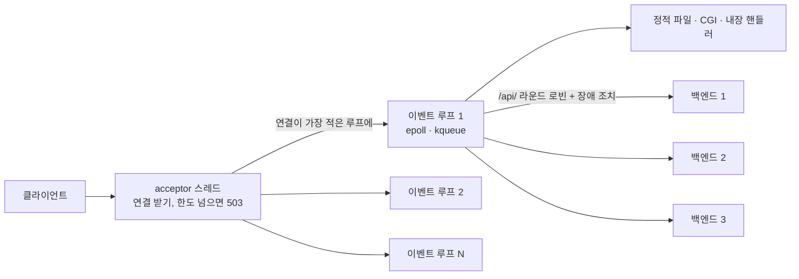
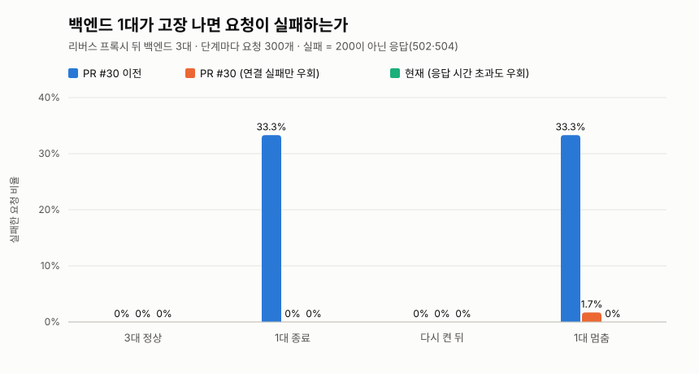
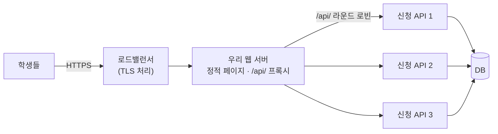
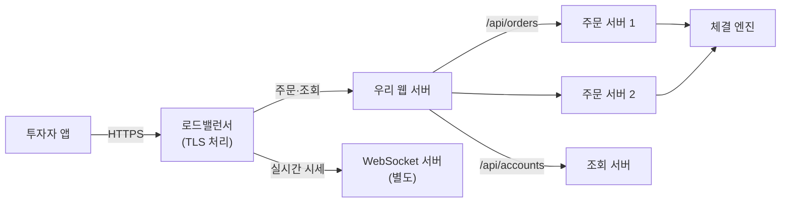
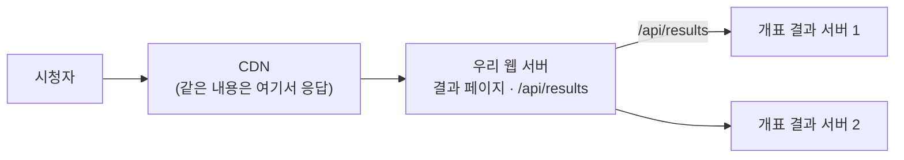
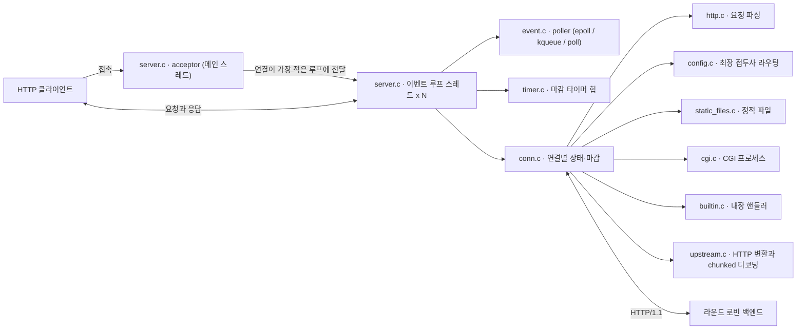

# mini-web-server

C와 POSIX API만으로 만든 HTTP 웹 서버입니다. 대규모 트래픽을 견디는 웹 서버의 세 가지 조건인 **빠르게, 안정적으로, 확장 가능하게**를 직접 구현하고 측정했습니다. 정글 13기 13주차 13팀 프로젝트입니다.

| 조건 | 테스트 | 결과 |
|---|---|---|
| **빠르게** | 노는 keep-alive 연결 9,000개가 붙어 있을 때의 처리량 | 13,536 → **41,667 req/s** (약 3.1배), p99 지연 7 ms → 3 ms |
| **안정적으로** | 백엔드 3대 중 1대가 죽거나 멈췄을 때 실패한 요청 | 33.3% → **0%** |
| **확장 가능하게** | 이벤트 루프를 1개에서 2개로 늘렸을 때 처리량 | 43,002 → **67,826 req/s** (약 1.6배) |

**발표 순서**

1. [대규모 트래픽이란](#1-대규모-트래픽이란)
2. [세 가지 조건을 어떻게 구현했나](#2-세-가지-조건을-어떻게-구현했나): [빠르게](#21-빠르게) · [안정적으로](#22-안정적으로) · [확장 가능하게](#23-확장-가능하게)
3. [어떻게 활용할까: 트래픽 유형별](#3-어떻게-활용할까-트래픽-유형별): [수강신청](#31-수강신청-순간-폭주형) · [주식 거래](#32-주식-거래-연결-유지형) · [선거 개표](#33-선거-개표-읽기-폭주형)
4. [한계와 상용 웹 서버의 해결 방법](#4-한계와-상용-웹-서버의-해결-방법)
5. [결론](#5-결론)
6. [부록: 실행 방법, 내부 구조, 테스트, 측정 재현](#부록)

---

## 1. 대규모 트래픽이란

대규모 트래픽은 단순히 "요청이 많다"가 아닙니다. 서비스마다 몰리는 **모양**이 다릅니다.

| 장면 | 무슨 일이 생기나 |
|---|---|
| 수강신청 오픈 10시 정각 | 수만 명이 같은 순간에 접속하고 몇 분 안에 끝납니다. |
| 주식 시장 개장 9시 | 앱을 켜 둔 채 시세만 보는 사용자가 하루 종일 많고, 개장과 마감 직전에 주문이 폭증합니다. |
| 선거 개표 방송 밤 | 모두가 같은 결과 페이지를 몇 초마다 새로고침합니다. |

이런 상황에서 웹 서버가 갖춰야 할 조건은 세 가지입니다.

- **빠르게**: 접속만 해 두고 가만히 있는 사용자가 수천 명이어도, 실제 요청은 느려지지 않아야 합니다.
- **안정적으로**: 뒤쪽 서버 하나가 고장 나거나 요청이 폭주해도 서비스 전체가 멈추지 않아야 합니다.
- **확장 가능하게**: CPU 코어나 서버를 늘리면 처리량도 늘어야 합니다.

우리 서버의 전체 구조는 다음과 같습니다.



---

## 2. 세 가지 조건을 어떻게 구현했나

측정 환경은 Apple M5(10코어) MacBook, macOS이며, 서버와 부하 도구가 같은 컴퓨터(127.0.0.1)에서 동작합니다. 측정 방법과 재현 방법은 [부록 D](#d-측정-방법과-재현)에 있습니다.

### 2.1 빠르게

**문제.** 예전 서버는 이벤트 루프가 한 바퀴 돌 때마다 **모든 연결**을 훑었습니다. `poll`에 연결 목록 전체를 넘기고, 돌아온 결과도 전부 확인하고, 마감 시간과 끝난 연결도 전부 확인했습니다. 그래서 아무 일도 하지 않는 keep-alive 연결이 늘어날수록 실제 요청 처리까지 느려졌습니다.

**구현.** 루프가 **일이 생긴 연결만** 다루도록 바꿨습니다.

| 루프가 하는 일 | 예전 | 지금 |
|---|---|---|
| 기다리기 | `poll`에 전체 목록 전달 | epoll(Linux)·kqueue(macOS)에 미리 등록, 준비된 연결만 돌려받음 |
| 일이 생긴 연결 찾기 | 모든 연결 확인 | 이벤트에 딸린 포인터로 바로 찾음 |
| 얼마나 잘지 정하기 | 모든 연결의 마감 비교 | 타이머 힙 맨 위 하나 |
| 마감 지난 연결 찾기 | 모든 연결 확인 | 타이머 힙에서 지난 것만 꺼냄 |
| 끝난 연결 정리 | 모든 연결 확인 | 이번 바퀴에 건드린 연결만 |

**테스트: 노는 연결이 늘어도 처리량이 유지되는가.** 이벤트 루프 1개에 아무 요청도 보내지 않는 연결을 0~9,000개 붙여 두고, 활성 연결 50개로 `GET /index.html`을 8초 동안 반복 요청했습니다. 3회 측정의 중앙값입니다.


| 노는 연결 수 | 기존 서버 | 새 루프 + poll | 새 루프 + kqueue |
|---:|---:|---:|---:|
| 0 | 42,233 | 42,176 | 43,012 |
| 1,000 | 36,788 | 37,063 | 43,009 |
| 2,500 | 27,033 | 27,984 | 42,614 |
| 5,000 | 20,449 | 20,827 | 42,043 |
| 9,000 | 13,536 (−68%) | 14,135 (−66%) | **41,667 (−3%)** |
| p99 지연 (9,000개) | 7 ms | 7 ms | **3 ms** |

(초당 처리 요청 수. 괄호는 노는 연결 0개 대비 변화. 실패 0건)

- 노는 연결이 9,000개일 때 기존 서버는 처리량이 3분의 1로 줄었지만, kqueue 서버는 거의 그대로입니다.
- 새 루프를 `poll`로 돌리면 기존과 거의 같습니다. 차이를 만든 것은 커널 대기 방식(poll → epoll·kqueue)이고, 루프 정리는 그 효과가 나도록 "매 바퀴 모든 연결 훑기"를 없앤 기반 작업입니다.

### 2.2 안정적으로

**문제.** 리버스 프록시 뒤의 백엔드 하나가 고장 나면, 그 백엔드 차례인 요청이 모두 실패했습니다. 백엔드 3대 중 1대가 죽으면 요청 3개 중 1개가 오류였습니다.

**구현.**

- **백엔드 장애 조치(passive health check)**: 실제 요청이 실패하면 그 백엔드를 10초 동안 빼고, 다시 보내도 안전한 요청은 다른 백엔드로 재시도합니다.

  | 실패 | 백엔드 제외 | 재시도 | 재시도해도 되는 이유 |
  |---|---|---|---|
  | 연결 거부, 연결 시간 초과 | O | 모든 요청 | 백엔드가 요청을 한 바이트도 받지 못했음 |
  | 연결 후 응답 없음 | O | `GET`·`HEAD`만 | 조회는 여러 번 실행해도 결과가 같음. `POST`는 이미 처리됐을 수 있어(중복 주문) 재시도하지 않음 |

  10초가 지나면 그 백엔드를 다시 후보로 넣고, 다음 요청이 연결해 보며 복구 여부를 확인합니다.
- **타임아웃**: 헤더를 아주 천천히 보내는 연결(Slowloris)은 10초, 노는 keep-alive 연결은 5초, 응답 없는 백엔드는 3초 뒤 끊습니다.
- **자원 한도**: 동시 연결이 한도를 넘으면 503으로 바로 거절하고, 헤더·본문이 너무 크면 431·413으로 거절합니다. fd가 고갈되면 잠시 연결 받기를 쉽니다.
- **오류 격리**: 클라이언트가 먼저 끊어도(`SIGPIPE`) 그 연결만 닫히고 서버는 계속 동작합니다.
- **보안**: 본문 길이를 모호하게 보내는 request smuggling 시도를 400으로 막습니다.
- **우아한 종료**: 종료 신호를 받으면 처리 중인 응답은 끝까지 보낸 뒤 종료합니다.

**테스트: 백엔드 1대가 고장 나면 요청이 실패하는가.** 리버스 프록시 뒤에 백엔드 3대를 두고, 단계마다 `/api/` 요청 300개(동시 10개)를 보냈습니다.



| 단계 | 장애 조치 없음 | 연결 실패만 우회 | **현재** |
|---|---:|---:|---:|
| 3대 정상 | 0% | 0% | 0% |
| 1대 종료 (프로세스 죽음) | 33.3% (502 100건) | 0% | **0%** |
| 종료한 1대를 다시 켠 뒤 | 0% | 0% | **0%** |
| 1대 멈춤 (연결은 되지만 응답 없음) | 33.3% (504 100건) | 1.7% (504 5건) | **0%** |

- 죽은 백엔드든 멈춘 백엔드든 클라이언트가 받은 오류는 0건입니다. 남은 2대가 150개씩 나눠 처리했습니다.
- 다시 켠 백엔드는 10초 뒤 자동으로 다시 쓰여, 3대가 100개씩 고르게 나눠 받았습니다.
- 다만 "1대 멈춤"에서 10건은 3초를 기다린 뒤 성공했습니다. 멈춘 백엔드를 처음 알아채기까지 이미 그쪽으로 간 요청들입니다([한계](#4-한계와-상용-웹-서버의-해결-방법) 참고).

### 2.3 확장 가능하게

**구현.**

- **멀티 이벤트 루프**: acceptor 스레드 하나가 연결을 받아, 맡은 연결이 가장 적은 이벤트 루프 스레드에 넘깁니다. 루프 수는 설정 `workers`로 정하며 기본값은 CPU 코어 수입니다. 연결은 처음 맡은 루프에서 끝까지 처리하므로 연결 처리 코드에 잠금이 필요 없습니다.
- **리버스 프록시 + 라운드 로빈**: `/api/` 같은 경로를 여러 백엔드에 번갈아 나눠 줍니다. 백엔드를 늘리려면 설정 파일 한 줄에 주소를 추가하면 됩니다.

  ```text
  proxy /api/ 127.0.0.1:8001 127.0.0.1:8002 127.0.0.1:8003
  ```

**테스트: 이벤트 루프를 늘리면 처리량이 느는가.** 노는 연결 없이 루프 수를 1, 2, 4, 8로 바꿨습니다. 부하 도구(`ab`) 하나는 코어 하나만 쓰므로 4개를 동시에 띄워 합쳤습니다.


| 루프 수 | 기존 서버 | 현재 |
|---:|---:|---:|
| 1 | 41,924 | 43,002 |
| 2 | 65,735 | **67,826** (약 1.6배) |
| 4 | 60,343 | 61,703 |
| 8 | 58,441 | 58,594 |

- 루프 2개에서 처리량이 약 1.6배가 됐습니다.
- 4개 이상에서는 늘지 않았습니다. 서버와 부하 도구 4개가 같은 컴퓨터의 코어 10개를 나눠 써서, 부하 도구가 한계였을 가능성이 큽니다. 확장성을 정확히 보려면 부하 도구를 다른 컴퓨터에서 돌려야 합니다.
- 노는 연결이 없으면 기존 서버와 차이가 3% 안쪽입니다. 이번 개선은 평소 성능을 해치지 않습니다.

---

## 3. 어떻게 활용할까: 트래픽 유형별

같은 대규모 트래픽이라도 모양이 다르면 웹 서버를 쓰는 방법이 달라집니다. 세 가지 유형을 하나씩 살펴봅니다. 이 장의 구성은 설계 제안이며, 서비스 단위로 측정하지는 않았습니다.

| | 수강신청 | 주식 거래 | 선거 개표 |
|---|---|---|---|
| 유형 | 순간 폭주형 | 연결 유지형 | 읽기 폭주형 |
| 트래픽 모양 | 오픈 순간에 몰리고 금방 끝남 | 하루 종일 접속 유지 + 개장·마감 폭주 | 모두가 같은 페이지를 반복해서 읽음 |
| 우리 서버와 맞는 정도 | **잘 맞음** | **절반만 맞음** | **일부 맞음** |
| 보완할 것 | 대기열, 사용자별 요청 제한 | HTTPS, 실시간 시세(WebSocket) | 캐시, CDN |

### 3.1 수강신청: 순간 폭주형

10시 정각에 수만 명이 동시에 접속하고, 몇 분 뒤면 트래픽이 사라집니다. 이때 가장 중요한 것은 **서버가 죽지 않고, 감당할 수 없는 요청은 빨리 거절하는 것**입니다.



- **우리 서버가 맡는 것**: 신청 페이지(정적 파일) 응답, 신청 요청을 API 서버 여러 대에 분배
- **강점**
  - 동시 연결 한도를 넘으면 503으로 바로 거절해서, 서버 전체가 멈추는 대신 일부 사용자에게 "다시 시도"를 안내합니다.
  - 느린 연결과 응답 없는 API 서버를 타임아웃으로 끊어 자원이 묶이지 않습니다.
  - API 서버 하나가 고장 나도 나머지가 처리합니다(장애 실험 0% 실패).
- **보완할 것**
  - **대기열이 없습니다.** 503을 받은 사용자는 새로고침을 반복하고, 먼저 온 순서가 보장되지 않습니다. 실제 수강신청·티켓팅 서비스는 별도 대기열 서버로 순번을 매깁니다.
  - **사용자별 요청 제한이 없습니다.** 매크로가 1초에 수십 번 요청해도 막지 못합니다.

### 3.2 주식 거래: 연결 유지형

앱을 켜 둔 채 시세를 보는 사용자가 하루 종일 많고, 9시 개장과 마감 직전에 주문이 몰립니다. **주문은 정확해야 합니다.** 주문이 빠지거나 두 번 들어가면 안 됩니다.



- **우리 서버가 맡는 것**: 주문·잔고 조회 API를 뒤쪽 서버에 분배. 실시간 시세는 별도 WebSocket 서버가 맡습니다.
- **강점**
  - 앱을 켜 두기만 한 사용자가 수천 명이어도 주문 처리가 느려지지 않습니다(노는 연결 9,000개에서도 처리량 유지).
  - **중복 주문 없는 재시도**: 주문(`POST`)은 서버가 요청을 받기 전에 실패한 경우에만 다른 서버로 다시 보냅니다. 요청을 보낸 뒤 응답이 없으면 이미 체결됐을 수 있으므로 다시 보내지 않고 오류를 알립니다. 잔고 조회(`GET`)는 응답이 없어도 다른 서버로 다시 보냅니다.
- **보완할 것**
  - **HTTPS를 직접 처리하지 못합니다.** 앞단 로드밸런서가 TLS를 맡아야 합니다.
  - **실시간 시세용 WebSocket이 없습니다.** 시세 서버는 별도로 두어야 합니다.
  - 주문 서버가 멈추면 그 사실을 알아채기까지(3초) 이미 보낸 주문들은 기다립니다.

### 3.3 선거 개표: 읽기 폭주형

개표 방송을 보던 사람들이 모두 같은 결과 페이지를 몇 초마다 새로고침합니다. 요청은 많지만 **내용은 모두 같고**, 쓰기는 거의 없습니다.



- **우리 서버가 맡는 것**: 결과 페이지(HTML·JS·이미지)를 정적 파일로 직접 응답, 최신 개표 결과 API를 결과 서버에 분배
- **강점**
  - 정적 파일은 뒤쪽 서버를 거치지 않고 바로 응답합니다.
  - 결과 서버를 여러 대 두고 나눠 받을 수 있고, 한 대가 고장 나도 이어서 응답합니다.
- **보완할 것**
  - **캐시가 없습니다.** 10만 명이 같은 결과를 요청하면 10만 번 모두 결과 서버에 물어봅니다. 상용 서버는 응답을 1~2초만 저장해 두는 마이크로캐싱만으로도 뒤쪽 요청을 크게 줄입니다.
  - 정적 파일을 읽어서 보내는 과정에서 메모리 복사가 일어납니다(`sendfile` 미사용).

---

## 4. 한계와 상용 웹 서버의 해결 방법

활용 사례에서 나온 보완점과 내부 구현의 한계를 정리했습니다.

| 한계 | 영향 | 상용 웹 서버(nginx 등)의 해결 방법 |
|---|---|---|
| HTTPS(TLS) 미지원 | 앞단에 로드밸런서가 꼭 필요함 | nginx `ssl` 모듈로 직접 TLS 처리 |
| WebSocket·HTTP/2 미지원 | 실시간 시세, 채팅을 직접 중계할 수 없음 | `Upgrade` 헤더 프록시(WebSocket), HTTP/2 지원 |
| 캐시 없음 | 같은 응답도 매번 백엔드에 요청 | `proxy_cache`(마이크로캐싱), 앞단 CDN |
| 사용자별 요청 제한·대기열 없음 | 매크로·봇을 막지 못하고, 503을 받은 사용자의 순서가 보장되지 않음 | `limit_req`·`limit_conn`, 별도 대기열 서비스 |
| passive 헬스체크만 있음 | 멈춘 백엔드를 처음 알아채기까지 실제 요청이 기다림(장애 실험에서 10건이 3초 대기) | active 헬스체크: 몇 초마다 `/health`를 직접 확인해 사용자보다 먼저 장애를 찾음(nginx Plus, HAProxy, AWS ALB) |
| 백엔드 연결을 요청마다 새로 맺음 | 요청마다 연결 비용이 듦 | upstream `keepalive`로 백엔드 연결 재사용 |
| 정적 파일을 `read`·`send`로 복사 | 큰 파일에서 메모리 복사 비용 | `sendfile`로 커널 안에서 바로 전송 |
| 설정을 바꾸면 재시작해야 함 | 바꾸는 동안 연결이 끊김 | `nginx -s reload`로 연결을 유지한 채 설정 교체 |
| 서버 한 대 구성 | 이 서버 자체가 단일 장애점 | 여러 대를 띄우고 앞단 L4 로드밸런서로 분산 |

측정에도 한계가 있습니다. 서버와 부하 도구를 같은 컴퓨터에서 돌렸고, 부하 도구 `ab`는 지연을 ms 단위로만 보여 줍니다. Linux(epoll)에서는 같은 측정을 아직 하지 않았습니다.

---

## 5. 결론

- 대규모 트래픽을 견디는 웹 서버의 핵심 원리인 **이벤트 기반 I/O(epoll·kqueue), 자원 한도와 타임아웃, 장애 우회, 멀티 루프와 부하 분산**을 C로 직접 구현했습니다.
- 그 효과를 숫자로 확인했습니다. 노는 연결 9,000개에서 처리량 3.1배, 백엔드 장애 시 실패 33.3% → 0%, 루프 2개에서 처리량 1.6배입니다.
- 수강신청 같은 순간 폭주형 서비스에서는 앞단 서버로 바로 쓸 수 있는 구조이고, 주식 거래나 선거 개표처럼 HTTPS·WebSocket·캐시가 필요한 서비스에서는 상용 웹 서버와 같은 방식으로 보완하면 됩니다.

---

## 부록

- [A. 실행 방법과 설정](#a-실행-방법과-설정)
- [B. 내부 구조](#b-내부-구조)
- [C. 테스트](#c-테스트)
- [D. 측정 방법과 재현](#d-측정-방법과-재현)
- [E. 팀 PR 통합 기록](#e-팀-pr-통합-기록)

### A. 실행 방법과 설정

```sh
make
make run                            # http://localhost:18080/
make run PORT=8080
```

- 정적 파일은 `/` 또는 `/docs/`에서 확인합니다.
- CGI와 내장 핸들러는 `/cgi-bin/add?a=1&b=2`, `/builtin/add?a=1&b=2`, `/form.html`에서 확인합니다.
- 프록시는 별도 터미널에서 `make backends`와 `make run-proxy`를 실행합니다. `curl http://localhost:18080/api/hello`를 반복하면 백엔드가 순환합니다. 백엔드 하나를 종료하고 `curl`을 반복하면, 남은 백엔드들만 번갈아 응답하고 서버 로그에 `marked down ... retrying next backend`가 남습니다.

`./webserver -c conf/proxy.conf 18080 www`로 [예제 설정](conf/proxy.conf)을 읽을 수 있습니다. 값을 바꾼 뒤 서버를 재시작하면 적용됩니다.

| 설정 | 기본값 | 동작 |
|---|---:|---|
| `workers` | CPU 코어 수(최대 8) | 이벤트 루프 스레드 수 (1~64) |
| `event_backend` | `auto` | `auto`(Linux `epoll`, macOS `kqueue`), `poll`, `epoll`, `kqueue`. 환경변수 `WEBSERVER_EVENT_BACKEND`가 있으면 설정보다 우선합니다. |
| `keepalive_timeout_ms` | 5000 | 첫 요청 또는 다음 요청의 첫 바이트를 기다리는 시간 |
| `header_timeout_ms` | 10000 | 첫 바이트부터 헤더 전체를 받기까지의 시간 |
| `body_timeout_ms` | 30000 | 헤더를 파싱한 뒤 본문 전체를 받기까지의 시간 |
| `cgi_timeout_ms` | 5000 | CGI 실행 제한 시간 |
| `proxy_connect_timeout_ms` | 1000 | 백엔드 연결 제한 시간 |
| `proxy_timeout_ms` | 5000 | 백엔드 I/O가 진전되기를 기다리는 시간. 예제 파일은 3000을 사용합니다. |
| `proxy_fail_timeout_ms` | 10000 | 연결 실패나 응답 시간 초과가 난 백엔드를 건너뛰는 시간 |
| `proxy_retry_timeout_ms` | 5000 | 응답 시간 초과 뒤 재시도를 시작할 수 있는 한도(첫 시도부터). 재시도마다 기다림이 쌓이지 않게 합니다. |

### B. 내부 구조



1. `main.c`가 포트·문서 루트와 설정을 읽고 리스닝 소켓을 엽니다. `server.c`의 acceptor가 연결을 받아 이벤트 루프 스레드에 넘기고, 각 루프는 자기 연결의 fd, 종료 신호, CGI 자식 종료를 poller(`event.h`, 기본은 Linux `epoll`·macOS `kqueue`)로 감시합니다.
2. `http.c`가 요청 헤더를 파싱하고, `conn.c`가 필요한 본문을 읽습니다. 요청을 받은 뒤 **프록시 규칙 → `/cgi-bin/` → `/builtin/` → 정적 파일** 순서로 처리합니다.
3. 정적 파일은 작은 조각으로 읽어 보냅니다. CGI는 자식의 stdin과 stdout을 동시에 감시하고, 출력으로 HTTP 응답을 구성한 뒤 자식을 회수합니다.
4. 프록시는 가장 긴 경로 접두사의 백엔드 중 하나를 라운드 로빈으로 선택합니다. 실패한 백엔드는 잠시 건너뛰고 다른 백엔드로 재시도합니다([백엔드 장애 조치](#백엔드-장애-조치)). 백엔드에는 요청마다 HTTP/1.1 연결을 사용하며, 응답 헤더를 확인한 뒤 본문을 스트리밍합니다. 클라이언트 쪽은 응답 경계가 명확하면 keep-alive를 유지할 수 있습니다.

#### 멀티 이벤트 루프

```text
[메인 스레드 = acceptor]                  [이벤트 루프 스레드 x N]
poll(listen, stop)                        poller_wait([wake, stop, 자식회수, 자기 연결들...])
  accept → 전체 연결 수 >= 한도면 503         wake: inbox 의 연결을 꺼내 conn_new
         → 연결이 가장 적은 루프의    ──▶    이벤트가 온 연결만 conn_handle
           inbox 에 넣고 wake 파이프에 1바이트  마감 지난 연결만 conn_timeout, 끝난 연결 정리
  stop  → listen 닫기, 루프 join
```

- 연결은 처음 맡은 루프에서 끝까지 처리합니다. 그래서 `conn.c`의 상태 머신은 lock 없이 단일 스레드 때와 같은 코드로 돕니다.
- 스레드끼리 공유하는 값만 보호합니다. 전체·루프별 연결 수와 요청 통계, 라운드 로빈 카운터, 백엔드 down 시각은 atomic이고, CGI 고아 목록과 루프 inbox는 mutex입니다.
- 루프 하나가 느린 작업에 잠시 막혀도 다른 루프의 연결은 계속 진행됩니다.
- 시그널은 메인 스레드만 받습니다(루프 스레드는 `pthread_sigmask`로 막음). 핸들러는 파이프에 1바이트를 쓰고, 루프들은 그 파이프를 감시해서 종료와 CGI 자식 종료를 알게 됩니다.
- fd를 만든 뒤 `FD_CLOEXEC`를 켜기 전에 다른 스레드가 CGI를 `fork`하면 그 fd가 자식에게 샙니다. `accept`, 백엔드 `socket`, CGI의 `pipe`+`fork`는 같은 잠금(`cgi_fd_guard`) 안에서 합니다.
- 동시 연결 한도(`max_conns`)는 모든 루프를 합친 값입니다. 스레드 수는 설정 파일의 `workers`로 정하며, 생략하면 CPU 코어 수(최대 8)입니다.

#### 이벤트 백엔드 (poller)

루프는 `poll`을 직접 부르지 않고 `event.h`의 poller에 fd를 **등록**해 둡니다. 백엔드는 실행할 때 고르며, 시작 로그에 `kqueue backend`처럼 표시됩니다.

| 백엔드 | 파일 | OS | 기다릴 때 비용 |
|---|---|---|---|
| `poll` | `event_poll.c` | 모두 | 등록된 fd 전체를 매번 커널에 넘기고 훑음: O(등록된 fd 수) |
| `epoll` | `event_epoll.c` | Linux | 커널이 등록을 들고 있고 준비된 fd만 돌려줌: O(준비된 fd 수) |
| `kqueue` | `event_kqueue.c` | macOS, BSD | epoll과 같음 |

| 함수 | 하는 일 |
|---|---|
| `poller_add` / `poller_mod` / `poller_del` | fd를 감시 목록에 넣기 / 기다리는 이벤트 바꾸기 / 빼기 |
| `poller_wait` | 준비된 fd와 등록할 때 넘긴 `ptr`을 돌려줌 (level-triggered) |

- 연결이 기다리는 fd가 바뀔 수 있는 때는 그 연결을 건드린 직후뿐입니다(`conn_new`, `conn_handle`, `conn_timeout`, `conn_shutdown`). 루프는 그때만 `watch_sync`로 `conn_pollfds` 결과와 등록을 비교해 바뀐 것만 알립니다.
- 이벤트의 `ptr`이 연결(`struct watch`)을 가리키므로, 이벤트가 온 연결을 배열을 훑지 않고 바로 찾습니다.
- `conn.c`는 감시 중인 fd를 닫기 직전에 훅(`conn_set_close_hook`)을 부릅니다. epoll/kqueue는 등록을 커널이 들고 있어서, 루프 모르게 fd를 닫고 같은 번호로 새 fd를 열면(예: 프록시 재시도) 새 fd가 등록되지 않습니다. 또 epoll은 `fork`로 자식이 같은 파일을 들고 있으면 `close` 뒤에도 등록이 남습니다. 훅에서 등록을 먼저 지워 두 문제를 막습니다.
- 백엔드별 차이: kqueue는 읽기와 쓰기를 따로 알려 주므로 한 fd의 결과가 두 번 올 수 있고(루프가 합침), 기다리는 이벤트가 없는(events=0) fd의 끊김은 알려 주지 않습니다. macOS에서는 `poll`도 이 경우를 알려 주지 않아 동작 차이는 없었습니다.

#### 타이머 힙과 한 바퀴의 비용

연결의 마감(`conn_deadline`)은 루프마다 하나 있는 최소 힙(`timer.h`)에 둡니다. 힙 노드는 연결(`struct watch`) 안에 있고 자기 위치를 알고 있어서, 마감이 바뀌면 그 자리에서 옮기고 연결이 끝나면 바로 뺍니다.

연결의 등록·마감·종료 여부가 바뀌는 때는 그 연결을 건드린 직후뿐이므로, 루프는 그때 `watch_touched` 한 곳에서 셋을 함께 맞춥니다. 그래서 한 바퀴의 일은 열린 연결 수가 아니라 일이 생긴 연결 수에 비례합니다(마감 처리는 연결당 O(log n)). 종료 신호를 받았을 때만 모든 연결을 한 번 훑습니다.

#### 백엔드 장애 조치

실제 요청의 실패(연결 실패, 응답 시간 초과)를 보고 백엔드 상태를 판단합니다(passive health check). 다시 보내도 안전한 요청만 다른 백엔드로 재시도합니다.

| 상황 | 처리 |
|---|---|
| 연결 거부, 도달 불가, `proxy_connect_timeout_ms` 초과 | 그 백엔드를 `proxy_fail_timeout_ms` 동안 down으로 표시하고, 같은 요청을 아직 시도하지 않은 다음 백엔드로 보냅니다. 요청을 한 바이트도 보내기 전이라 `POST`도 재시도합니다. |
| down인 백엔드 | 라운드 로빈 순서에서 건너뜁니다. 시간이 지나면 다시 후보가 되고, 또 실패하면 다시 down이 됩니다. |
| 살아 있는 백엔드가 없음 | down인 백엔드라도 한 번씩 시도해 복구를 확인합니다. 모두 실패하면 502(마지막 실패가 연결 타임아웃이면 504)입니다. |
| 연결 후 `proxy_timeout_ms` 동안 응답 없음 (멈춘 백엔드) | 그 백엔드를 `proxy_fail_timeout_ms` 동안 down으로 표시합니다. `GET`·`HEAD`이고 클라이언트에게 아직 응답을 보내기 전이며 첫 시도부터 `proxy_retry_timeout_ms` 안이면, 아직 시도하지 않은 백엔드로 재시도합니다. 그 밖에는 504입니다. `POST` 등은 백엔드가 이미 처리했을 수 있으므로(중복 주문) 재시도하지 않습니다. |
| 연결 후 응답이 망가지거나 중간에 끊김 | 요청을 이미 보냈으므로 재시도하지 않고 502를 반환합니다. |

#### 프록시 응답의 경계

| 백엔드 응답 | 프록시의 완료 조건 |
|---|---|
| `Content-Length`가 있음 | 선언된 바이트 수를 전달하면 완료합니다. |
| `Transfer-Encoding: chunked` | 청크 길이와 마지막 0 청크 뒤의 빈 줄까지 읽습니다. HTTP/1.1 클라이언트에 맞춰 청크를 다시 만들고, HTTP/1.0 클라이언트에는 디코딩한 본문을 보내고 연결을 닫습니다. 청크 확장과 트레일러는 전달하지 않습니다. |
| 길이 헤더가 없음 | 백엔드 EOF까지 중계한 뒤 클라이언트 연결을 닫습니다. |
| `HEAD`, 204, 304 | 헤더만 전송합니다. |

응답 헤더 전송 전의 백엔드 오류는 502, 제한 시간 초과는 504를 반환합니다. 응답 전송이 시작된 뒤 백엔드가 본문을 끝내지 못하면 해당 클라이언트 연결을 닫습니다. HTTP 응답 경계는 [RFC 9112 §6.3 및 §7.1](https://www.rfc-editor.org/rfc/rfc9112.html#section-6.3)을 참고했습니다.

#### 요청 본문의 경계

요청 본문도 같은 규칙으로 끝을 정합니다(`http_body_framing`). 본문 끝을 잘못 판단하면 뒤에 숨긴 요청이 별도 요청으로 처리되는 request smuggling이 생기므로, 모호한 경우는 거절하고 연결을 닫습니다.

| 요청 헤더 | 처리 |
|---|---|
| `Content-Length` | 선언된 바이트 수만큼 읽습니다. |
| `Transfer-Encoding: chunked` | 응답 중계에 쓰는 chunked 디코더로 마지막 0 청크까지 읽어 본문을 모읍니다. 디코딩한 본문은 CGI에는 `CONTENT_LENGTH`, 백엔드에는 `Content-Length`로 전달합니다. 본문 뒤에 이어 온 요청은 keep-alive로 계속 처리합니다. |
| `Transfer-Encoding`과 `Content-Length`가 함께 있음 | 400 |
| HTTP/1.0 요청의 `Transfer-Encoding`, `chunked`가 마지막이 아니거나 두 번 이상 | 400 |
| `gzip, chunked`처럼 지원하지 않는 코딩 | 501 |
| 잘못된 청크 형식, 1 MiB 초과 | 400, 413 |

### C. 테스트

```sh
make test
make smoke smoke-dynamic smoke-concurrency
make asan test-asan
WEBSERVER=./webserver_asan make smoke-dynamic
# 같은 테스트를 poll 백엔드로
WEBSERVER_EVENT_BACKEND=poll make smoke smoke-dynamic smoke-concurrency
```

동적 스모크는 20 MiB 응답 중계, 백엔드 전송 완료 전 첫 본문 수신, 느린 클라이언트가 있는 동안의 정적 응답, 고정 길이·`chunked`·EOF 경계, 잘린 응답, 설정으로 바뀐 타임아웃을 확인합니다. 요청 쪽은 chunked 본문(잘게 나눈 전송, 파이프라이닝, CGI·프록시 전달)과 TE·CL 충돌, 지원하지 않는 코딩, 형식 오류, 한도 초과를 확인합니다. 백엔드 장애 조치는 죽은 백엔드·응답 없는 주소·멈춘 백엔드 재시도, `POST` 재시도 여부, 복구를 확인합니다. 기존 CGI·정적 파일·keep-alive·라운드 로빈 테스트도 함께 실행합니다.

### D. 측정 방법과 재현

측정 환경: Apple M5(10코어) MacBook, macOS. 서버와 부하 도구가 같은 컴퓨터(127.0.0.1)에서 동작합니다. 결과 CSV와 그래프는 `bench/results/`에 있습니다.

**비교 대상**

| 이름 | 커밋 | 내용 |
|---|---|---|
| 기존 서버 | `5bae131` | 매 바퀴 모든 연결의 `pollfd`를 다시 만들고 `poll` |
| 새 루프 + poll / kqueue | 현재 | 등록 방식 루프와 타이머 힙, 커널 대기는 `poll` 또는 kqueue(Linux는 epoll) |
| 장애 조치 없음 | `77886d0` | 백엔드 장애 조치 이전 |
| 연결 실패만 우회 | PR #30 | 연결 단계의 실패만 장애로 판단 |

**빠르게·확장 가능하게 (`bench/bench.py`)**: 측정 한 번마다 다음을 자동으로 합니다.

1. 테스트용 설정으로 서버를 띄웁니다. 노는 연결 실험은 `workers 1`(루프 하나가 모든 연결을 맡아 차이가 그대로 드러나게)이고, 노는 연결이 도중에 끊기지 않게 `keepalive_timeout_ms 600000`을 씁니다. 백엔드는 환경변수 `WEBSERVER_EVENT_BACKEND`로 고릅니다.
2. TCP 연결 N개를 열고 아무 요청도 보내지 않은 채 들고 있습니다(노는 keep-alive 사용자).
3. 노는 연결이 모두 열려 있는지 확인합니다. 서버가 거절하거나 끊었으면 측정을 멈춥니다.
4. `ab`로 1초 동안 데운 뒤, `ab -k -c 50 -t 8`로 연결 50개를 keep-alive로 유지하며 8초 동안 `GET /index.html`(1,438바이트 정적 파일)을 반복 요청합니다. 루프 수 실험은 `ab` 4개를 동시에 띄워 합칩니다.
5. 초당 처리 요청 수, 50%·99% 지연, 실패 수를 기록하고, 노는 연결을 RST로 끊은 뒤(TIME_WAIT가 남지 않게) 서버를 종료합니다.
6. 1~5를 3번 반복해 중앙값을 씁니다.

**안정적으로 (`bench/failover.py`)**: 리버스 프록시 뒤에 백엔드 3대(`tests/backend.py`)를 두고, 정상 → 1대 종료(`SIGKILL`) → 다시 켠 뒤(10초 대기) → 1대 멈춤(`SIGSTOP`) 단계마다 `/api/` 요청 300개를 동시 10개로 보냅니다. 상태 코드, 응답한 백엔드, 지연, 1초 넘게 걸린 요청 수를 기록합니다.

**측정의 한계**: `ab`는 지연을 ms 정수로만 보여 주고, HTTP/1.0 keep-alive로 요청합니다. macOS의 임시 포트가 약 16,000개라 노는 연결은 9,000개까지 측정했습니다. 서버의 동시 연결 한도(`max_conns`)는 최대 10,000입니다.

**다시 측정하기 (Linux/WSL).** Linux에서는 `kqueue` 대신 `epoll`을 씁니다. 저장소 폴더에서 차례로 실행합니다.

```sh
sudo apt install -y apache2-utils                       # ab
make                                                     # 새 서버
git worktree add ../before 5bae131 && make -C ../before webserver   # 비교용 기존 서버
git worktree add ../pre30 77886d0 && make -C ../pre30 webserver     # 장애 조치 이전 서버

# 빠르게 (약 12분)
python3 bench/bench.py idle --series before=../before/webserver: \
    --series poll=./webserver:poll --series epoll=./webserver:epoll --csv bench/results/linux-idle.csv
# 확장 가능하게 (약 6분)
python3 bench/bench.py workers --series before=../before/webserver: \
    --series epoll=./webserver:epoll --csv bench/results/linux-workers.csv
# 안정적으로 (약 3분)
python3 bench/failover.py --series before=../pre30/webserver --series retry=./webserver \
    --csv bench/results/linux-failover.csv
# 그래프
for e in idle workers failover; do python3 bench/plot.py bench/results/linux-$e.csv bench/results/linux-$e.svg; done
```

- `bench.py`의 `--series 이름=실행파일:백엔드` 형식에서 백엔드 칸을 비우면 그 서버의 기본 방식으로 돕니다(기존 코드는 `poll`).
- 측정 중에는 다른 무거운 프로그램을 끄고, 측정을 두 개 동시에 돌리지 않습니다(포트를 바꾸려면 `BENCH_PORT`).
- 컴퓨터마다 숫자 자체는 다릅니다. 노는 연결이 늘 때 기존 서버와 `poll`은 떨어지고 epoll은 유지되는지, 추세를 비교합니다.

### E. 팀 PR 통합 기록

| 항목 | [PR #24 · Base Single Server](https://github.com/1224kang/mini-web-server/pull/24) | [PR #26 · 미니 웹 서버 1~6단계](https://github.com/1224kang/mini-web-server/pull/26) |
|---|---|---|
| 동시 접속 | 메인 스레드가 연결을 큐에 넣고 워커가 연결 하나를 담당합니다. 여러 요청을 병렬로 처리할 수 있고, 느린 연결과 유휴 keep-alive도 워커를 점유합니다. | 단일 스레드가 `poll`로 준비된 소켓과 파이프를 처리합니다. 유휴 연결은 fd와 연결 상태로 관리합니다. |
| 정적·동적 처리 | 정적 `GET`과 백엔드 프록시를 지원합니다. | 정적·프록시 `HEAD`, 외부 CGI, 내장 `add`와 `echo`를 지원합니다. |
| 프록시 응답 | 백엔드에 HTTP/1.1로 요청하고 본문을 받는 대로 전달합니다. `chunked` 응답도 중계합니다. | 백엔드에 HTTP/1.0으로 요청하고 EOF까지 모은 뒤 응답을 전송합니다. 전송 전에 잘린 본문을 판별할 수 있고 전체 응답 크기는 버퍼 한도의 영향을 받습니다. |
| 타임아웃 | keep-alive와 소켓 읽기·쓰기 대기 시간을 설정 파일에서 바꿉니다. | 헤더·본문 수신에 각각 전체 마감이 있습니다. 클라이언트 쪽 기본 시간은 코드에 정해져 있습니다. |
| 메모리 검사 | 일반·ASan 산출물을 각각 보관하고 `make test-asan`을 제공합니다. | `make asan`이 일반 빌드와 같은 실행 파일을 다시 만듭니다. |
| 요청 본문 | 최대 10 MiB, `Expect: 100-continue` 지원 | 최대 1 MiB, `Expect: 100-continue` 응답 미구현 |

| 가져온 요소 | 적용 방식과 근거 |
|---|---|
| #26의 `poll`과 연결 상태 머신 | 클라이언트 소켓, 백엔드 소켓, CGI 파이프를 루프가 관리합니다. keep-alive, 파이프라이닝, CGI, HEAD의 기존 흐름을 활용하며 연결이 대기할 때 다른 연결을 진행할 수 있습니다. 이후 poller 등록 방식과 epoll·kqueue로 바꿨습니다. |
| #24의 응답 스트리밍과 HTTP/1.1 백엔드 | 백엔드가 읽기 가능하면 본문을 조각 단위로 받고, 클라이언트가 쓰기 가능하면 보냅니다. 보낼 데이터가 남아 있는 동안 해당 백엔드 읽기를 잠시 멈춥니다. 최대 64 KiB의 본문 조각과 인코딩 여유 공간만 두고, 응답을 받는 중에 전송을 시작할 수 있습니다. |
| #24의 설정 파일과 #26의 단계별 마감 | keep-alive, 헤더, 본문 제한 시간을 각각 설정합니다. 헤더와 본문은 단계가 시작될 때 마감을 정하므로, 바이트를 조금씩 보내도 마감이 계속 밀리지 않습니다. 기존 기본값을 유지합니다. |
| #24의 ASan 빌드 분리 | 일반 빌드는 `build/release/`와 `webserver`, 검사 빌드는 `build/asan/`와 `webserver_asan`을 사용합니다. 두 실행 파일과 오브젝트를 동시에 보관하고 같은 단위 테스트를 두 모드에서 돌릴 수 있습니다. |

동시성은 #24의 "메인 스레드는 accept, 처리는 워커" 구조와 #26의 이벤트 루프를 합쳤습니다. 워커 하나가 연결 하나를 붙잡는 대신, 워커마다 이벤트 루프를 돌려 여러 연결을 처리합니다. 요청 본문 한도는 현재 1 MiB이며 큰 업로드와 `Expect: 100-continue` 처리는 후속 과제입니다.
