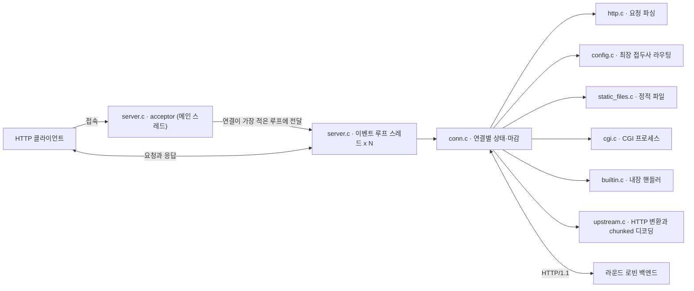

# mini-web-server

정글 13기 13주차 13팀의 C/POSIX 웹 서버입니다. accept 전용 스레드 1개와 이벤트 루프 스레드 N개(기본 CPU 코어 수, Linux는 `epoll`·macOS는 `kqueue`)로 HTTP 요청, 정적 파일, CGI, 내장 핸들러, 리버스 프록시를 처리합니다.

## 기존 PR 비교

| 항목 | [PR #24 · Base Single Server](https://github.com/1224kang/mini-web-server/pull/24) | [PR #26 · 미니 웹 서버 1~6단계](https://github.com/1224kang/mini-web-server/pull/26) |
|---|---|---|
| 동시 접속 | 메인 스레드가 연결을 큐에 넣고 워커가 연결 하나를 담당합니다. 여러 요청을 병렬로 처리할 수 있고, 느린 연결과 유휴 keep-alive도 워커를 점유합니다. | 단일 스레드가 `poll`로 준비된 소켓과 파이프를 처리합니다. 유휴 연결은 fd와 연결 상태로 관리합니다. |
| 정적·동적 처리 | 정적 `GET`과 백엔드 프록시를 지원합니다. | 정적·프록시 `HEAD`, 외부 CGI, 내장 `add`와 `echo`를 지원합니다. |
| 프록시 응답 | 백엔드에 HTTP/1.1로 요청하고 본문을 받는 대로 전달합니다. `chunked` 응답도 중계합니다. | 백엔드에 HTTP/1.0으로 요청하고 EOF까지 모은 뒤 응답을 전송합니다. 전송 전에 잘린 본문을 판별할 수 있고 전체 응답 크기는 버퍼 한도의 영향을 받습니다. |
| 타임아웃 | keep-alive와 소켓 읽기·쓰기 대기 시간을 설정 파일에서 바꿉니다. | 헤더·본문 수신에 각각 전체 마감이 있습니다. 클라이언트 쪽 기본 시간은 코드에 정해져 있습니다. |
| 메모리 검사 | 일반·ASan 산출물을 각각 보관하고 `make test-asan`을 제공합니다. | `make asan`이 일반 빌드와 같은 실행 파일을 다시 만듭니다. |
| 요청 본문 | 최대 10 MiB, `Expect: 100-continue` 지원 | 최대 1 MiB, `Expect: 100-continue` 응답 미구현 |

## 통합 설계와 선택 근거

| 가져온 요소 | 적용 방식과 근거 |
|---|---|
| #26의 `poll`과 연결 상태 머신 | 클라이언트 소켓, 백엔드 소켓, CGI 파이프를 루프가 관리합니다. keep-alive, 파이프라이닝, CGI, HEAD의 기존 흐름을 활용하며 연결이 대기할 때 다른 연결을 진행할 수 있습니다. |
| #24의 응답 스트리밍과 HTTP/1.1 백엔드 | 백엔드가 읽기 가능하면 본문을 조각 단위로 받고, 클라이언트가 쓰기 가능하면 보냅니다. 보낼 데이터가 남아 있는 동안 해당 백엔드 읽기를 잠시 멈춥니다. 최대 64 KiB의 본문 조각과 인코딩 여유 공간만 두고, 응답을 받는 중에 전송을 시작할 수 있습니다. |
| #24의 설정 파일과 #26의 단계별 마감 | keep-alive, 헤더, 본문 제한 시간을 각각 설정합니다. 헤더와 본문은 단계가 시작될 때 마감을 정하므로, 바이트를 조금씩 보내도 마감이 계속 밀리지 않습니다. 기존 기본값을 유지합니다. |
| #24의 ASan 빌드 분리 | 일반 빌드는 `build/release/`와 `webserver`, 검사 빌드는 `build/asan/`와 `webserver_asan`을 사용합니다. 두 실행 파일과 오브젝트를 동시에 보관하고 같은 단위 테스트를 두 모드에서 돌릴 수 있습니다. |

동시성은 #24의 "메인 스레드는 accept, 처리는 워커" 구조와 #26의 이벤트 루프를 합쳤습니다. 워커 하나가 연결 하나를 붙잡는 대신, 워커마다 이벤트 루프를 돌려 여러 연결을 처리합니다(아래 [멀티 이벤트 루프](#멀티-이벤트-루프)). 요청 본문 한도는 현재 1 MiB이며 큰 업로드와 `Expect: 100-continue` 처리는 후속 과제입니다.

### 멀티 이벤트 루프

```text
[메인 스레드 = acceptor]                  [이벤트 루프 스레드 x N]
poll(listen, stop)                        poll([wake, stop, 자식회수, 자기 연결들...])
  accept → 전체 연결 수 >= 한도면 503         wake: inbox 의 연결을 꺼내 conn_new
         → 연결이 가장 적은 루프의    ──▶    준비된 연결마다 conn_handle / conn_timeout
           inbox 에 넣고 wake 파이프에 1바이트  끝난 연결 정리
  stop  → listen 닫기, 루프 join
```

- 연결은 처음 맡은 루프에서 끝까지 처리합니다. 그래서 `conn.c`의 상태 머신은 lock 없이 단일 스레드 때와 같은 코드로 돕니다.
- 스레드끼리 공유하는 값만 보호합니다. 전체·루프별 연결 수와 요청 통계, 라운드 로빈 카운터는 atomic이고, CGI 고아 목록과 루프 inbox는 mutex입니다.
- 루프 하나가 느린 작업에 잠시 막혀도 다른 루프의 연결은 계속 진행됩니다.
- 시그널은 메인 스레드만 받습니다(루프 스레드는 `pthread_sigmask`로 막음). 핸들러는 파이프에 1바이트를 쓰고, 루프들은 그 파이프를 `poll`해서 종료와 CGI 자식 종료를 알게 됩니다.
- fd를 만든 뒤 `FD_CLOEXEC`를 켜기 전에 다른 스레드가 CGI를 `fork`하면 그 fd가 자식에게 샙니다. `accept`, 백엔드 `socket`, CGI의 `pipe`+`fork`는 같은 잠금(`cgi_fd_guard`) 안에서 합니다.
- 동시 연결 한도(`max_conns`)는 모든 루프를 합친 값입니다. 스레드 수는 설정 파일의 `workers`로 정하며, 생략하면 CPU 코어 수(최대 8)입니다.

### 이벤트 백엔드 (poller)

루프는 `poll`을 직접 부르지 않고 `event.h`의 poller에 fd를 **등록**해 둡니다. 백엔드는 실행할 때 고르며, 시작 로그에 `kqueue backend`처럼 표시됩니다.

| 백엔드 | 파일 | OS | 기다릴 때 비용 |
|---|---|---|---|
| `poll` | `event_poll.c` | 모두 | 등록된 fd 전체를 매번 커널에 넘기고 훑음: O(등록된 fd 수) |
| `epoll` | `event_epoll.c` | Linux | 커널이 등록을 들고 있고 준비된 fd만 돌려줌: O(준비된 fd 수) |
| `kqueue` | `event_kqueue.c` | macOS, BSD | epoll과 같음 |

| 함수 | 하는 일 |
|---|---|
| `poller_add` / `poller_mod` / `poller_del` | fd를 감시 목록에 넣기 / 기다리는 이벤트 바꾸기 / 빼기 |
| `poller_wait` | 준비된 fd와 등록할 때 넘긴 `ptr`을 돌려줌 (level-triggered) |

- 연결이 기다리는 fd가 바뀔 수 있는 때는 그 연결을 건드린 직후뿐입니다(`conn_new`, `conn_handle`, `conn_timeout`, `conn_shutdown`). 루프는 그때만 `watch_sync`로 `conn_pollfds` 결과와 등록을 비교해 바뀐 것만 알립니다.
- 이벤트의 `ptr`이 연결(`struct watch`)을 가리키므로, 이벤트가 온 연결을 배열을 훑지 않고 바로 찾습니다.
- `conn.c`는 감시 중인 fd를 닫기 직전에 훅(`conn_set_close_hook`)을 부릅니다. epoll/kqueue는 등록을 커널이 들고 있어서, 루프 모르게 fd를 닫고 같은 번호로 새 fd를 열면(예: 프록시 재시도) 새 fd가 등록되지 않습니다. 또 epoll은 `fork`로 자식이 같은 파일을 들고 있으면 `close` 뒤에도 등록이 남습니다. 훅에서 등록을 먼저 지워 두 문제를 막습니다.
- 백엔드별 차이: kqueue는 읽기와 쓰기를 따로 알려 주므로 한 fd의 결과가 두 번 올 수 있고(루프가 합침), 기다리는 이벤트가 없는(events=0) fd의 끊김은 알려 주지 않습니다. macOS에서는 `poll`도 이 경우를 알려 주지 않아 동작 차이는 없었습니다.

### 타이머 힙과 한 바퀴의 비용

연결의 마감(`conn_deadline`)은 루프마다 하나 있는 최소 힙(`timer.h`)에 둡니다. 힙 노드는 연결(`struct watch`) 안에 있고 자기 위치를 알고 있어서, 마감이 바뀌면 그 자리에서 옮기고 연결이 끝나면 바로 뺍니다.

| 루프가 하는 일 | 예전 | 지금 (epoll/kqueue) |
|---|---|---|
| 기다리기 | `poll`에 전체 목록 전달 | 준비된 fd만 돌려받음 |
| 얼마나 잘지 정하기 | 모든 연결의 마감 비교 | 힙 맨 위 하나 |
| 일이 생긴 연결 찾기 | 모든 연결의 `revents` 확인 | 이벤트의 `ptr`로 바로 |
| 마감 지난 연결 찾기 | 모든 연결의 마감 확인 | 힙 맨 위에서 지난 것만 꺼냄 |
| 끝난 연결 정리 | 모든 연결의 `conn_done` 확인 | 이번 바퀴에 건드린 연결 중 끝난 것만 |

연결의 등록·마감·종료 여부가 바뀌는 때는 그 연결을 건드린 직후뿐이므로, 루프는 그때 `watch_touched` 한 곳에서 셋을 함께 맞춥니다. 그래서 한 바퀴의 일은 열린 연결 수가 아니라 일이 생긴 연결 수에 비례합니다(마감 처리는 연결당 O(log n)). 종료 신호를 받았을 때만 모든 연결을 한 번 훑습니다.

## 서버 구성



1. `main.c`가 포트·문서 루트와 설정을 읽고 리스닝 소켓을 엽니다. `server.c`의 acceptor가 연결을 받아 이벤트 루프 스레드에 넘기고, 각 루프는 자기 연결의 fd, 종료 신호, CGI 자식 종료를 poller(`event.h`, 지금은 `poll` 백엔드)로 감시합니다.
2. `http.c`가 요청 헤더를 파싱하고, `conn.c`가 필요한 본문을 읽습니다. 요청을 받은 뒤 **프록시 규칙 → `/cgi-bin/` → `/builtin/` → 정적 파일** 순서로 처리합니다.
3. 정적 파일은 작은 조각으로 읽어 보냅니다. CGI는 자식의 stdin과 stdout을 동시에 감시하고, 출력으로 HTTP 응답을 구성한 뒤 자식을 회수합니다.
4. 프록시는 가장 긴 경로 접두사의 백엔드 중 하나를 라운드 로빈으로 선택합니다. 연결에 실패한 백엔드는 잠시 건너뛰고 다른 백엔드로 재시도합니다([백엔드 장애 조치](#백엔드-장애-조치)). 백엔드에는 요청마다 HTTP/1.1 연결을 사용하며, 응답 헤더를 확인한 뒤 본문을 스트리밍합니다. 클라이언트 쪽은 응답 경계가 명확하면 keep-alive를 유지할 수 있습니다.

| 백엔드 응답 | 프록시의 완료 조건 |
|---|---|
| `Content-Length`가 있음 | 선언된 바이트 수를 전달하면 완료합니다. |
| `Transfer-Encoding: chunked` | 청크 길이와 마지막 0 청크 뒤의 빈 줄까지 읽습니다. HTTP/1.1 클라이언트에 맞춰 청크를 다시 만들고, HTTP/1.0 클라이언트에는 디코딩한 본문을 보내고 연결을 닫습니다. 청크 확장과 트레일러는 전달하지 않습니다. |
| 길이 헤더가 없음 | 백엔드 EOF까지 중계한 뒤 클라이언트 연결을 닫습니다. |
| `HEAD`, 204, 304 | 헤더만 전송합니다. |

응답 헤더 전송 전의 백엔드 오류는 502, 제한 시간 초과는 504를 반환합니다. 응답 전송이 시작된 뒤 백엔드가 본문을 끝내지 못하면 해당 클라이언트 연결을 닫습니다. HTTP 응답 경계는 [RFC 9112 §6.3 및 §7.1](https://www.rfc-editor.org/rfc/rfc9112.html#section-6.3)을 참고했습니다.

### 요청 본문의 경계

요청 본문도 같은 규칙으로 끝을 정합니다(`http_body_framing`). 본문 끝을 잘못 판단하면 뒤에 숨긴 요청이 별도 요청으로 처리되는 request smuggling이 생기므로, 모호한 경우는 거절하고 연결을 닫습니다.

| 요청 헤더 | 처리 |
|---|---|
| `Content-Length` | 선언된 바이트 수만큼 읽습니다. |
| `Transfer-Encoding: chunked` | 응답 중계에 쓰는 chunked 디코더로 마지막 0 청크까지 읽어 본문을 모읍니다. 디코딩한 본문은 CGI에는 `CONTENT_LENGTH`, 백엔드에는 `Content-Length`로 전달합니다. 본문 뒤에 이어 온 요청은 keep-alive로 계속 처리합니다. |
| `Transfer-Encoding`과 `Content-Length`가 함께 있음 | 400 |
| HTTP/1.0 요청의 `Transfer-Encoding`, `chunked`가 마지막이 아니거나 두 번 이상 | 400 |
| `gzip, chunked`처럼 지원하지 않는 코딩 | 501 |
| 잘못된 청크 형식, 1 MiB 초과 | 400, 413 |

## 실행

```sh
make
make run                            # http://localhost:18080/
make run PORT=8080
```

- 정적 파일은 `/` 또는 `/docs/`에서 확인합니다.
- CGI와 내장 핸들러는 `/cgi-bin/add?a=1&b=2`, `/builtin/add?a=1&b=2`, `/form.html`에서 확인합니다.
- 프록시는 별도 터미널에서 `make backends`와 `make run-proxy`를 실행합니다. `curl http://localhost:18080/api/hello`를 반복하면 백엔드가 순환합니다.

### 백엔드 장애 조치

백엔드가 죽어 있어도 클라이언트가 502를 보지 않도록, 연결 단계의 실패를 기준으로 백엔드 상태를 판단합니다(passive health check).

| 상황 | 처리 |
|---|---|
| 연결 거부, 도달 불가, `proxy_connect_timeout_ms` 초과 | 그 백엔드를 `proxy_fail_timeout_ms` 동안 down으로 표시하고, 같은 요청을 아직 시도하지 않은 다음 백엔드로 보냅니다. 요청을 한 바이트도 보내기 전이라 `POST`도 재시도합니다. |
| down인 백엔드 | 라운드 로빈 순서에서 건너뜁니다. 시간이 지나면 다시 후보가 되고, 또 실패하면 다시 down이 됩니다. |
| 살아 있는 백엔드가 없음 | down인 백엔드라도 한 번씩 시도해 복구를 확인합니다. 모두 실패하면 502(마지막 실패가 연결 타임아웃이면 504)입니다. |
| 연결 후 응답 지연·중단 | 요청을 이미 보냈으므로 재시도하지 않고 504·502를 반환합니다. |

`make backends`와 `make run-proxy`를 띄운 뒤 백엔드 하나를 종료하고 `curl`을 반복하면, 남은 백엔드들만 번갈아 응답하고 서버 로그에 `marked down ... retrying next backend`가 남습니다.

### 타임아웃 설정

`./webserver -c conf/proxy.conf 18080 www`로 [예제 설정](conf/proxy.conf)을 읽을 수 있습니다. 값을 바꾼 뒤 서버를 재시작하면 적용됩니다.

| 설정 | 기본값 | 동작 |
|---|---:|---|
| `workers` | CPU 코어 수(최대 8) | 이벤트 루프 스레드 수 (1~64) |
| `event_backend` | `auto` | `auto`(Linux `epoll`, macOS `kqueue`), `poll`, `epoll`, `kqueue`. 환경변수 `WEBSERVER_EVENT_BACKEND`가 있으면 설정보다 우선합니다. |
| `keepalive_timeout_ms` | 5000 | 첫 요청 또는 다음 요청의 첫 바이트를 기다리는 시간 |
| `header_timeout_ms` | 10000 | 첫 바이트부터 헤더 전체를 받기까지의 시간 |
| `body_timeout_ms` | 30000 | 헤더를 파싱한 뒤 본문 전체를 받기까지의 시간 |
| `cgi_timeout_ms` | 5000 | CGI 실행 제한 시간 |
| `proxy_connect_timeout_ms` | 1000 | 백엔드 연결 제한 시간 |
| `proxy_timeout_ms` | 5000 | 백엔드 I/O가 진전되기를 기다리는 시간. 예제 파일은 3000을 사용합니다. |
| `proxy_fail_timeout_ms` | 10000 | 연결에 실패한 백엔드를 건너뛰는 시간 |

## 검증

```sh
make test
make smoke smoke-dynamic smoke-concurrency
make asan test-asan
WEBSERVER=./webserver_asan make smoke-dynamic
# 같은 테스트를 poll 백엔드로
WEBSERVER_EVENT_BACKEND=poll make smoke smoke-dynamic smoke-concurrency
```

동적 스모크는 20 MiB 응답 중계, 백엔드 전송 완료 전 첫 본문 수신, 느린 클라이언트가 있는 동안의 정적 응답, 고정 길이·`chunked`·EOF 경계, 잘린 응답, 설정으로 바뀐 타임아웃을 확인합니다. 요청 쪽은 chunked 본문(잘게 나눈 전송, 파이프라이닝, CGI·프록시 전달)과 TE·CL 충돌, 지원하지 않는 코딩, 형식 오류, 한도 초과를 확인합니다. 기존 CGI·정적 파일·keep-alive·라운드 로빈 테스트도 함께 실행합니다.
