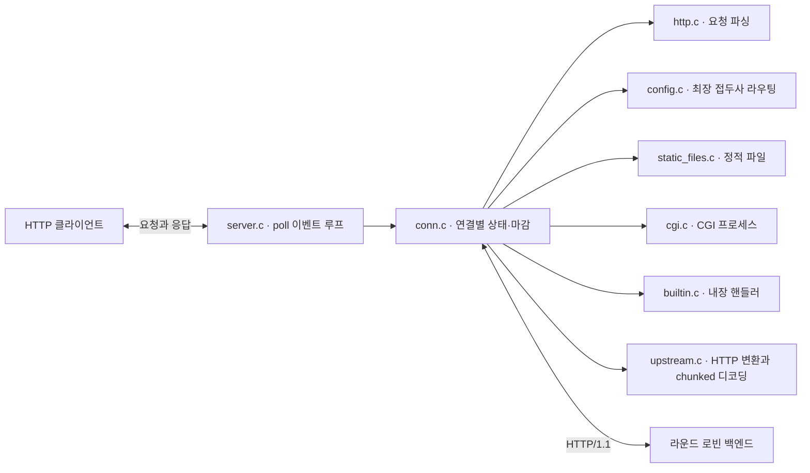

# mini-web-server

정글 13기 13주차 13팀의 C/POSIX 웹 서버입니다. 하나의 `poll` 이벤트 루프에서 HTTP 요청, 정적 파일, CGI, 내장 핸들러, 리버스 프록시를 처리합니다.

## 기존 PR 비교

| 항목 | [PR #24 · Base Single Server](https://github.com/1224kang/mini-web-server/pull/24) | [PR #26 · 미니 웹 서버 1~6단계](https://github.com/1224kang/mini-web-server/pull/26) |
|---|---|---|
| 동시 접속 | 메인 스레드가 연결을 큐에 넣고 워커가 연결 하나를 담당합니다. 여러 요청을 병렬로 처리할 수 있고, 느린 연결과 유휴 keep-alive도 워커를 점유합니다. | 단일 스레드가 `poll`로 준비된 소켓과 파이프를 처리합니다. 유휴 연결은 fd와 연결 상태로 관리합니다. |
| 정적·동적 처리 | 정적 `GET`과 백엔드 프록시를 지원합니다. | 정적·프록시 `HEAD`, 외부 CGI, 내장 `add`와 `echo`를 지원합니다. |
| 프록시 응답 | 백엔드에 HTTP/1.1로 요청하고 본문을 받는 대로 전달합니다. `chunked` 응답도 중계합니다. | 백엔드에 HTTP/1.0으로 요청하고 EOF까지 모은 뒤 응답을 전송합니다. 전송 전에 잘린 본문을 판별할 수 있고 전체 응답 크기는 버퍼 한도의 영향을 받습니다. |
| 타임아웃 | keep-alive와 소켓 읽기·쓰기 대기 시간을 설정 파일에서 바꿉니다. | 헤더·본문 수신에 각각 전체 마감이 있습니다. 클라이언트 쪽 기본 시간은 코드에 정해져 있습니다. |
| 메모리 검사 | 일반·ASan 산출물을 각각 보관하고 `make test-asan`을 제공합니다. | `make asan`이 일반 빌드와 같은 실행 파일을 다시 만듭니다. |
| 요청 본문 | 최대 10 MiB, `Expect: 100-continue` 지원 | 최대 1 MiB, `Expect: 100-continue` 응답 미구현 |

## 통합 설계와 선택 근거

| 가져온 요소 | 적용 방식과 근거 |
|---|---|
| #26의 `poll`과 연결 상태 머신 | 클라이언트 소켓, 백엔드 소켓, CGI 파이프를 루프가 관리합니다. keep-alive, 파이프라이닝, CGI, HEAD의 기존 흐름을 활용하며 연결이 대기할 때 다른 연결을 진행할 수 있습니다. |
| #24의 응답 스트리밍과 HTTP/1.1 백엔드 | 백엔드가 읽기 가능하면 본문을 조각 단위로 받고, 클라이언트가 쓰기 가능하면 보냅니다. 보낼 데이터가 남아 있는 동안 해당 백엔드 읽기를 잠시 멈춥니다. 최대 64 KiB의 본문 조각과 인코딩 여유 공간만 두고, 응답을 받는 중에 전송을 시작할 수 있습니다. |
| #24의 설정 파일과 #26의 단계별 마감 | keep-alive, 헤더, 본문 제한 시간을 각각 설정합니다. 헤더와 본문은 단계가 시작될 때 마감을 정하므로, 바이트를 조금씩 보내도 마감이 계속 밀리지 않습니다. 기존 기본값을 유지합니다. |
| #24의 ASan 빌드 분리 | 일반 빌드는 `build/release/`와 `webserver`, 검사 빌드는 `build/asan/`와 `webserver_asan`을 사용합니다. 두 실행 파일과 오브젝트를 동시에 보관하고 같은 단위 테스트를 두 모드에서 돌릴 수 있습니다. |

동시성의 기본 구조는 #26의 이벤트 루프입니다. 디스크 읽기나 계산이 이벤트 루프를 오래 막는다는 측정 결과가 있으면, 해당 작업을 워커에 넘기는 방안을 검토할 수 있습니다. 연결과 소켓의 관리는 이벤트 루프가 맡습니다. 요청 본문 한도는 현재 1 MiB이며 큰 업로드와 `Expect: 100-continue` 처리는 후속 과제입니다.

## 서버 구성



1. `main.c`가 포트·문서 루트와 설정을 읽고 리스닝 소켓을 엽니다. `server.c`는 접속, 종료 신호, CGI 자식 종료, 연결별 fd를 `poll`로 감시합니다.
2. `http.c`가 요청 헤더를 파싱하고, `conn.c`가 필요한 본문을 읽습니다. 요청을 받은 뒤 **프록시 규칙 → `/cgi-bin/` → `/builtin/` → 정적 파일** 순서로 처리합니다.
3. 정적 파일은 작은 조각으로 읽어 보냅니다. CGI는 자식의 stdin과 stdout을 동시에 감시하고, 출력으로 HTTP 응답을 구성한 뒤 자식을 회수합니다.
4. 프록시는 가장 긴 경로 접두사의 백엔드 중 하나를 라운드 로빈으로 선택합니다. 백엔드에는 요청마다 HTTP/1.1 연결을 사용하며, 응답 헤더를 확인한 뒤 본문을 스트리밍합니다. 클라이언트 쪽은 응답 경계가 명확하면 keep-alive를 유지할 수 있습니다.

| 백엔드 응답 | 프록시의 완료 조건 |
|---|---|
| `Content-Length`가 있음 | 선언된 바이트 수를 전달하면 완료합니다. |
| `Transfer-Encoding: chunked` | 청크 길이와 마지막 0 청크 뒤의 빈 줄까지 읽습니다. HTTP/1.1 클라이언트에 맞춰 청크를 다시 만들고, HTTP/1.0 클라이언트에는 디코딩한 본문을 보내고 연결을 닫습니다. 청크 확장과 트레일러는 전달하지 않습니다. |
| 길이 헤더가 없음 | 백엔드 EOF까지 중계한 뒤 클라이언트 연결을 닫습니다. |
| `HEAD`, 204, 304 | 헤더만 전송합니다. |

응답 헤더 전송 전의 백엔드 오류는 502, 제한 시간 초과는 504를 반환합니다. 응답 전송이 시작된 뒤 백엔드가 본문을 끝내지 못하면 해당 클라이언트 연결을 닫습니다. HTTP 응답 경계는 [RFC 9112 §6.3 및 §7.1](https://www.rfc-editor.org/rfc/rfc9112.html#section-6.3)을 참고했습니다.

## 실행

```sh
make
make run                            # http://localhost:18080/
make run PORT=8080
```

- 정적 파일은 `/` 또는 `/docs/`에서 확인합니다.
- CGI와 내장 핸들러는 `/cgi-bin/add?a=1&b=2`, `/builtin/add?a=1&b=2`, `/form.html`에서 확인합니다.
- 프록시는 별도 터미널에서 `make backends`와 `make run-proxy`를 실행합니다. `curl http://localhost:18080/api/hello`를 반복하면 백엔드가 순환합니다.

### 타임아웃 설정

`./webserver -c conf/proxy.conf 18080 www`로 [예제 설정](conf/proxy.conf)을 읽을 수 있습니다. 값을 바꾼 뒤 서버를 재시작하면 적용됩니다.

| 설정 | 기본값 | 동작 |
|---|---:|---|
| `keepalive_timeout_ms` | 5000 | 첫 요청 또는 다음 요청의 첫 바이트를 기다리는 시간 |
| `header_timeout_ms` | 10000 | 첫 바이트부터 헤더 전체를 받기까지의 시간 |
| `body_timeout_ms` | 30000 | 헤더를 파싱한 뒤 본문 전체를 받기까지의 시간 |
| `cgi_timeout_ms` | 5000 | CGI 실행 제한 시간 |
| `proxy_connect_timeout_ms` | 1000 | 백엔드 연결 제한 시간 |
| `proxy_timeout_ms` | 5000 | 백엔드 I/O가 진전되기를 기다리는 시간. 예제 파일은 3000을 사용합니다. |

## 검증

```sh
make test
make smoke smoke-dynamic smoke-concurrency
make asan test-asan
WEBSERVER=./webserver_asan make smoke-dynamic
```

동적 스모크는 20 MiB 응답 중계, 백엔드 전송 완료 전 첫 본문 수신, 느린 클라이언트가 있는 동안의 정적 응답, 고정 길이·`chunked`·EOF 경계, 잘린 응답, 설정으로 바뀐 타임아웃을 확인합니다. 기존 CGI·정적 파일·keep-alive·라운드 로빈 테스트도 함께 실행합니다.
